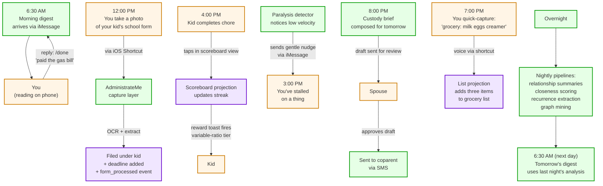
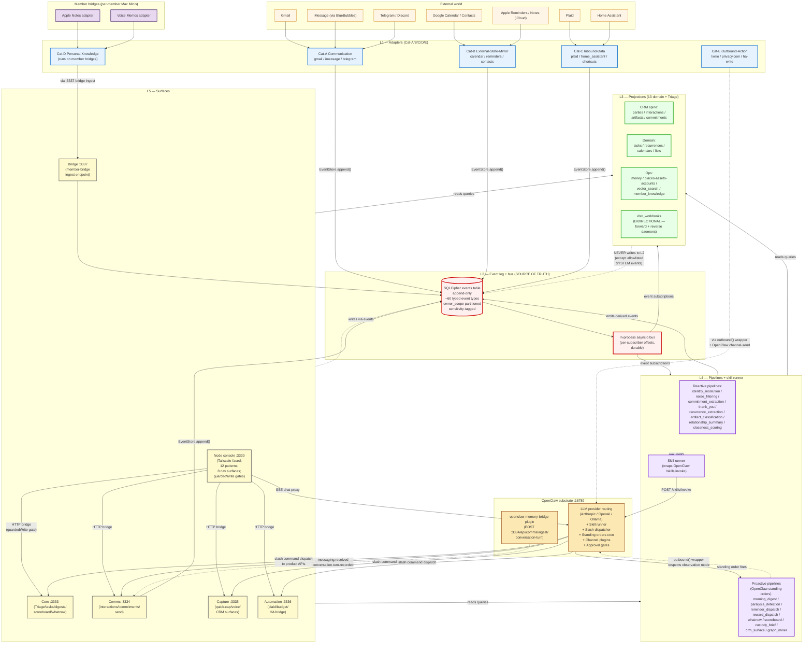

# What is AdministrateMe?

A comprehensive description of the codebase you're building, the platform it produces, and what your family will actually use it for — from one-line elevator pitch to full backend build spec, with diagrams for each audience.

---

# Part I — For the user (your family, friends, anyone you'd hand it to)

## One-liner

> **AdministrateMe is a household chief-of-staff that lives in your house, knows everyone in your life, remembers everything that happens, and proactively does what matters — without sending your family's data anywhere.**

## Short description (under 500 characters)

> AdministrateMe is a self-hosted operating system for running a family. It listens across your channels — iMessage, email, calendars, finances, voice notes — and turns them into a single timeline your household actually uses. It tracks who's said what to whom, what's owed to whom, what's coming up, and what to do next. It speaks ADHD. It runs on a small computer in your closet. Your data never leaves the house.

(490 chars)

## A slightly longer pitch (~150 words)

> Most people manage their household with twenty browser tabs, three calendars, a notes app full of half-thoughts, and a spouse who carries the rest in their head. AdministrateMe replaces that with one system, running on your own hardware, that watches what's already happening across your messages, email, calendars, and bank accounts — and uses that to surface what's actually next.
>
> It's a CRM for your real life: every person you know, every conversation you've had, every commitment you've made, every birthday you keep forgetting, every recurring bill, every artifact (school form, contract, medical record) you've handled. It's an ADHD neuroprosthetic: variable-ratio rewards on task completion, gentle paralysis nudges when you stall, and proactive morning digests that tell you what matters before you've had coffee. It's a chief-of-staff that respects observation mode until you trust it.

---

## Landing page

### Hero

**Your family runs on a hundred small things.**
**AdministrateMe runs them, on a computer in your closet, without sending anything home.**

[Read the field manual]   [See the architecture]   [Browse the build]

---

### What AdministrateMe is for

You have a family. Maybe one adult, maybe two, maybe more. Maybe kids, maybe coparents, maybe aging parents you check on. There's a lot to track. You're already tracking it — just badly. Tabs, notes, voicemails-you-meant-to-deal-with, the spouse's brain, the calendar nobody actually checks.

AdministrateMe is what that mess looks like when it's a real system. **One.** Living. **In your house.** With your data.

It does six things at once.

#### 1. A household Chief of Staff

Bills coming up. Recurring obligations. Emergencies-in-waiting (vehicle registrations, school deadlines, medical follow-ups). The Chief of Staff knows what's next, what you've been avoiding, and what's about to be late. Morning digest tells you in plain English. Slash commands let you ask `/whatnow` from any phone or computer in the house and get the right next thing.

#### 2. An ADHD cognitive neuroprosthetic

Built for people whose executive function isn't quite where they'd like it. **Variable-ratio rewards** on task completion (sometimes a small celebration, sometimes a big one — the unpredictability is the point). **Paralysis detection** at 3pm and 5pm: if you've stalled, the system notices and sends a gentle nudge with a specific tiny next step. **Endowed progress** — the system pre-credits you with starts so the bar isn't from zero. **Zeigarnik teasers** — the morning digest closes with one half-finished thought to nudge tomorrow's start. **Guilt vocabulary filtered out** of system-composed messages.

#### 3. A real CRM, but for your life

Not for sales. For your aunt's birthday and your kid's pediatrician and your handyman's phone number and which of your friends you haven't called in too long. Every person you've talked to, every email thread, every iMessage exchange, every commitment ("I'll send you those photos," "we should grab dinner") — captured, indexed, queryable. Search by relationship, by topic, by time-since-last-contact. The system surfaces who you're drifting from before you notice.

#### 4. Unified communications

iMessage. Email. SMS. WhatsApp. Telegram. Discord. Voice. AdministrateMe records inbound communication as scoped facts and puts only extracted action candidates into Triage. It composes outbound through OpenClaw on your behalf when you authorize, drafts replies you can approve, and never sends without your sign-off until you've run the system in observation mode long enough to trust it.

#### 5. A working-memory and capture system

You hold your phone up and say "remind me to buy garbage bags." That voice note becomes a structured task in the right list. You take a picture of a school form. OCR runs locally, the form is extracted and filed under your kid, the deadline becomes a recurrence. You quick-capture "grocery: milk, eggs, oat creamer." Goes to the right list, surfaces in the right context. Half of household work is capture-then-act; AdministrateMe is the capture layer that doesn't drop things.

#### 6. A sensor and signal layer

Plaid pulls your transactions and surfaces budget pace twice a week. Home Assistant signals (motion, doors, presence) flow into the event log when relevant. Apple Reminders syncs bidirectionally. Google Calendar reads (and writes back if you authorize). Your **family's actual operational state** — money flowing, people moving, things happening — gets sensor-fused into one stream that the system reasons against.

---

### What makes it different

#### It runs in your house, not in the cloud

A small Mac Mini sits on a shelf near your router. AdministrateMe runs there. **Your family's data never leaves the house** (except through the channels you'd already use anyway — Gmail, iCloud, etc., which the system reads from). When AdministrateMe sends an iMessage on your behalf, it goes through your Apple ID via the BlueBubbles bridge running on the same Mac. When it composes a digest using AI, the AI call goes out and back; the data stays local.

There's no AdministrateMe SaaS. No subscription beyond the one Anthropic charge for the model calls. If we vanish, your family's instance keeps working.

#### It's event-sourced

Everything that happens is an immutable event in an encrypted log. Every projection (your CRM, your tasks, your finance dashboard) is derived from that log. **You can rebuild the system from scratch and get exactly the same state.** Bad classification? Emit a corrective event; the projection updates; the old event stays in the log with a "supersedes" link. Nothing is ever lost; everything is provenance-tracked.

#### It speaks ADHD

Most productivity tools assume executive function works. AdministrateMe assumes it doesn't, and is designed around the failure modes — paralysis windows, dopamine deficits, the bar-from-zero problem, the guilt spiral when a task list grows. The carousel view shows one task at a time. The reward system varies its tier so completing tasks stays slightly rewarding. The morning digest hands you the day in three sentences, not seventy items.

#### Observation mode is default

Out of the bootstrap wizard, AdministrateMe is **watching but not acting**. It composes morning digests it doesn't send, drafts iMessage replies it doesn't deliver, calculates rewards it doesn't fire. Every suppressed action is logged. You review the log for a week. When you trust what it would have done, you flip observation off.

This is the trust onramp. Many systems demand trust on day one. This one earns it.

#### Privacy is layered, not hopeful

Three layers of privacy enforcement, all required:

- **Identity-first:** privileged content (law-practice email, medical records, financial details flagged sensitive) doesn't even enter the assistant's accounts. The privileged adapter has a sensitivity floor enforced at adapter level.
- **Session scope:** every read happens under a session that knows who's looking. Kid-role sessions don't see adult inboxes. The coparent's view of a custody brief is different from the household's view.
- **Event-level sensitivity:** every event in the log is tagged `normal`, `sensitive`, or `privileged`. Privileged events never enter vector search, never get summarized by LLMs, never appear in cross-owner queries. A privileged-access log records every non-owner read.

#### The Excel workbook is alive

There's a workbook in `~/.adminme/projections/adminme-ops.xlsx`. It updates when events happen. You open it; today's tasks are there. You edit a task description; the system emits an event from your edit; the projection updates; the workbook updates again. **Bidirectional projection.** For people who think in spreadsheets, AdministrateMe is operable from Excel.

#### It works in your existing channels

You don't have to learn a new app. You text the assistant on iMessage. You tell Siri to capture something via Shortcuts. You ask a question in the Telegram thread you share with your spouse. The console (a private webpage on your home network) is there when you want it — but most of the value flows through channels you already use.

---

### Who it's for

- **Parents** running households where two-or-more people coordinate calendars, finances, kids' commitments, recurring bills, ongoing projects.
- **Adults with ADHD** who need executive-function scaffolding that doesn't infantilize them.
- **Coparents** managing custody, school, medical, and child-related logistics across two households.
- **Caregivers** tracking medications, appointments, and operational state for aging parents.
- **People who care about data sovereignty** — your relationships, finances, and family logistics shouldn't live on someone else's servers.
- **Households with a technically inclined person** who can give an afternoon to bootstrap and an ongoing 30 min/week to tune. AdministrateMe is self-hosted; that's a tradeoff.

### Who it is NOT for

- **Solo people with no family operational load.** AdministrateMe earns its complexity when you have multiple people, multiple channels, real money, real obligations. A single individual could use it; the value-to-complexity ratio is better with a household.
- **People who'd rather use a SaaS and forget about it.** AdministrateMe needs you to bootstrap, observe, occasionally tune. It's a tool, not a product.
- **Households allergic to a small computer in the closet.** The Mac Mini is non-optional.
- **Tenants who'd prefer a third party hold their data.** AdministrateMe explicitly puts the data with you, including the obligations of that (backups, hardware, occasional debugging).

### What you get when you finish bootstrap

Your Mac Mini is running. The console is live on your home network (Tailscale gives you secure access from anywhere). The bootstrap wizard has paired your channels, set up your member profiles, seeded your CRM with the people you know. Observation mode is on. For 7 days, you review what the system would have sent. Then you flip observation off, and the family is served by a chief of staff that learned your patterns before it acted.

After that, the work becomes occasional tuning. Add a new family member when one arrives. Install a new pack when you want a new behavior. Run a build prompt when you want a new feature. The system grows with you.

### Honest limits

- **First-party Apple integration on the Mac Mini.** Apple Notes, Voice Memos, iMessage. These work because you sign in with the family's Apple ID on the Mac Mini. The system doesn't have access to your phone's Apple ID separately — it relies on iCloud sync.
- **Self-hosting reality.** Your Mac Mini needs power, internet, occasional reboots, occasional updates. You'll back up to Backblaze. If the Mac Mini dies, your backups restore to a new one in an hour.
- **OpenClaw API spend.** AdministrateMe uses OpenClaw, which calls Anthropic (or another provider you configure). That's an API spend — probably $5-30/month depending on how active your family is. Not a SaaS subscription, but real cost.
- **Not magic at OCR.** The system extracts text from documents you scan, but messy handwriting won't always parse. Voice transcription is good but not perfect.
- **Phase B has a learning curve.** Setting up the Mac Mini, OpenClaw, BlueBubbles, Tailscale, Plaid credentials — that's a Saturday. There's a field manual but it's still a Saturday.

---

## Diagram for the user: a day in your AdministrateMe household

A non-technical view of how a typical day flows through the system. Render at mermaid.live.

This is the rhythm. The system runs whether you're watching or not. Most of what's happening happens in the background; what you see is a small fraction (the digest, the nudge, the toast). The rest is the system absorbing your day into its state.

---

# Part II — For the backend developer

## Build spec

### Mission statement

AdministrateMe is an event-sourced household operating system. It is built as a single-tenant, multi-member, self-hostable platform layered on top of OpenClaw (an LLM-substrate gateway). It is simultaneously a household chief-of-staff, an ADHD cognitive neuroprosthetic, a household-and-professional CRM, a unified communications stream, a working-memory + capture layer, and a sensor/signal integration layer.

The first family it serves is a real one (Stice family, Atlanta GA). The codebase is **tenant-agnostic** — every household runs an instance from the same code with their own data in their own instance directory. The first family is a fixture; the platform is universal.

### Architecture: Five layers

The codebase is strictly layered. Each layer depends only on the layers below it. Cross-layer violation is a build failure.

#### L1 — Adapters

Channel-family-specific translators that read from external sources and emit typed events into L2. Adapters never write projections, never call pipelines, never compose outbound messages. They translate sources into events.

Adapter categories (per [D19], the five-category epistemic taxonomy):

- **Cat-A — Communication:** inbound/outbound messaging (Gmail, iMessage via BlueBubbles, Telegram, Discord, WhatsApp, SMS via Twilio)
- **Cat-B — External-State-Mirror:** sync of state owned by external systems (Google Calendar, Apple Reminders, Apple Calendar, Apple Contacts, Google Contacts, CalDAV)
- **Cat-C — Inbound-Data:** read-only sensors and feeds (Plaid transactions, Home Assistant signals, iOS Shortcut webhooks)
- **Cat-D — Personal-Knowledge:** per-member knowledge sources, runs on member bridges (Apple Notes, Voice Memos, optionally Obsidian)
- **Cat-E — Outbound-Action:** outbound side effects that don't fit Cat-A (Privacy.com, Lob, Home Assistant write, Twilio outbound)

Runtimes are orthogonal to categories: an adapter is either a **standalone Python process** or an **OpenClaw plugin** depending on what it integrates with. Messaging adapters (iMessage/Telegram/Discord) live as OpenClaw plugins because OpenClaw owns channel transport. Most others are standalone Python.

#### L2 — Event log + bus

The source of truth. Append-only, SQLCipher-encrypted at rest, partitioned logically by `owner_scope`.

- **Append-only enforced three ways:** code (single `EventStore.append()` owns the writable connection), SQLite trigger (refuses UPDATE/DELETE on `events`), unit test (asserts both).
- **Row schema:** `event_id` (Crockford base32 ULID-shape TEXT per [D16]), `event_type` (dotted, e.g. `messaging.received`), `schema_version`, `occurred_at`, `recorded_at`, `source_adapter`, `source_account_id`, `owner_scope`, `visibility_scope`, `sensitivity` (`normal`/`sensitive`/`privileged`), `correlation_id`, `causation_id`, `payload_json`, `raw_ref`, `actor_identity`.
- **Typed event registry:** every `event_type` has a Pydantic model at `adminme/lib/event_types/<namespace>/<type>.py`, a monotonically-increasing integer `schema_version`, and chained upcasters on schema change (per [D7]).
- **Async API over sync driver** per [D14]: `async def append`, `async def read_since` implemented over a synchronous `sqlcipher3` connection dispatched through `asyncio.to_thread`, with an `asyncio.Lock` for writes. (No drop-in async SQLCipher driver exists in Python in 2026; `aiosqlite` doesn't support SQLCipher.)
- **Two bus implementations:** `InProcessBus` (asyncio queues + durable `bus_consumer_offsets` table) is the default; `RedisStreamsBus` is the spec'd alternate for future scale-out. Both satisfy the `EventBus` Protocol.
- **Sidecar storage:** payloads >64KB live at `~/.adminme/data/raw_events/<yyyy>/<mm>/<event_id>.json.zst`; artifacts (email bodies, images, PDFs) at `~/.adminme/data/artifacts/<yyyy>/<mm>/<sha256>.<ext>`, referenced as `artifact://<sha256>` in `raw_ref`.

The L2 contract is the most-cited invariant cluster in the codebase. See `docs/SYSTEM_INVARIANTS.md §1` for the canonical list.

#### L3 — Projections

Deterministic pure functions from event subsets to read-model state. Each projection has a `name`, `version` (bumped to trigger rebuild), event-type subscription list, durable cursor, idempotent `apply(event)`, and a `rebuild()` that truncates and replays from event 0 producing state equivalent to the live cursor.

**14 registered projections**: thirteen domain-truth capabilities plus the
derived Triage adjudication read model (D26):

| # | Projection | Owns | Notable property |
|---|---|---|---|
| 3.1 | `parties` | Persons / organizations / households | The CRM core; `identifiers.value_normalized` canonicalized for exact-match merge |
| 3.2 | `interactions` | Touchpoints | Deduplicated; aggregates multiple raw events per row |
| 3.3 | `artifacts` | Documents / images / structured records | OCR + typed extraction per kind |
| 3.4 | `commitments` | Obligations between parties | Tracks propose→confirm→complete with provenance |
| 3.5 | `tasks` | Household work | ADMINISTRATEME-specific; rich fields (energy, effort, micro_script, waiting_on) |
| 3.6 | `recurrences` | RRULE templates | RFC 5545; `next_occurrence`, `lead_time_days`, `trackable` |
| 3.7 | `calendars` | External calendar events | Read at runtime; privacy filter applied at read time, not ingest |
| 3.8 | `places_assets_accounts` | Three linked entity families | Cross-referenced; vault refs only (no raw credentials) |
| 3.9 | `money` | Money flows | `amount_minor` + ISO 4217; links to artifact/account/interaction |
| 3.10 | `vector_search` | Semantic index over non-privileged content | `sqlite-vec`; excludes `sensitivity='privileged'` rows entirely |
| 3.11 | `xlsx_workbooks` | Two Excel workbooks on disk | **Bidirectional projection** — forward daemon regenerates, reverse daemon detects edits and emits events |
| 3.12 | `member_knowledge` | Per-member personal knowledge | Populated by member-bridge ingest; private to the owning member |
| 3.13 | `lists` | First-class shopping/wishlist/etc. lists | Per [D18], distinct from tasks |
| 3.14 | `triage` | Pending extracted/derived candidates | Rebuildable human gate; never authoritative household truth |

**Hard rules on projections** (per `SYSTEM_INVARIANTS.md §2`):
- Pure function of `(state, event)` — no wall-clock reads, no random, no UUID generation, no network calls, no calls to other projections beyond cursor advance.
- Never writes back to the event log. A projection emitting a domain event is a bug. The only legal projection-emits are SYSTEM events (e.g., `xlsx.regenerated`) and they're allowlisted in `ALLOWED_EMITS`.
- Read via `Session(current_user, requested_scopes)`; no global DB connection; scope predicates auto-appended to every query.

**The CRM is the spine** (per `BUILD.md §THE CRM IS THE SPINE OF THIS SYSTEM`). The `parties + identifiers + memberships + relationships + interactions + commitments + artifacts` projection cluster is the platform's data model. Every product surface (Capture, Comms, Core, Automation) reads against this spine. Per [D4]: products own surfaces, projections own data, events move state.

#### L4 — Pipelines + skill runner

Reactive pipelines subscribe to events and emit derived events / proposals / skill calls. Proactive pipelines are scheduled as OpenClaw standing orders.

**Two kinds:**

- **Reactive** — run inside the AdministrateMe pipeline runner; subscribe via `triggers.events` in `pipeline.yaml`.
- **Proactive** — register as OpenClaw standing orders at product boot; OpenClaw owns scheduling, approval gating via `exec-approvals`, channel delivery. Per [D1]: standing orders register as workspace-prose `AGENTS.md` entries paired with `openclaw cron add` invocations (not a typed plugin-hook API).

**Reactive pipelines:**
- `identity_resolution` — exact-match or Levenshtein-similarity merge suggestions on new identifiers; never auto-merges above threshold
- `noise_filtering` — `classify_message_nature@v2` skill on inbound messages
- `commitment_extraction` — `classify_commitment_candidate@v1` + `extract_commitment_fields@v1`; emits `CommitmentProposed` events
- `thank_you_detection` — specialization of commitment extraction for gratitude
- `recurrence_extraction` — birthdays from contacts, anniversaries from notes, renewals from parsed docs
- `artifact_classification` — OCR → classify → typed structured extraction
- `relationship_summarization` — nightly 3-sentence Party summaries over a rolling 90-day window
- `closeness_scoring` — nightly Party tier (1-5) from interaction frequency / mutuality / time-since-last-contact

**Proactive pipelines** (registered as OpenClaw standing orders):
- `morning_digest` — per-member at ~06:30 local; validation-guarded (any fabricated id zeroes the message with a sentinel)
- `reward_dispatch` — on task/commitment completion; rolls tier (done/warm/delight/jackpot) per profile's `reward_distribution`
- `paralysis_detection` — per ADHD-profile member at 15:00 and 17:00 local; deterministic, never invokes LLM
- `reminder_dispatch` — every 15 min; observation-mode aware
- `whatnow_ranking` — on-demand via `/whatnow`; deterministic scoring
- `scoreboard_projection` — maintains streaks, completion rates, grace tokens per member
- `custody_brief` — 20:00 local daily if a coparent Relationship exists
- `crm_surface` — weekly + on-demand; emits `crm.gap_detected`, `crm.birthday_upcoming`, `crm.hosting_imbalance`
- `graph_miner` — nightly 03:00; proposes parties/interactions/commitments/money flows from captures

**The skill runner** wraps OpenClaw's skill system. Every skill call goes through `await run_skill(skill_id, inputs, ctx)`, which:
1. Validates inputs against `input.schema.json`
2. Checks `sensitivity_required` (refuses privileged inputs unless skill declares it)
3. Checks `context_scopes_required ⊆ Session.requested_scopes`
4. Invokes `POST http://127.0.0.1:18789/skills/invoke` with `{skill_name, inputs, correlation_id, session_context, dmScope}`
5. Optionally post-processes via `handler.py`
6. Validates output against `output.schema.json`
7. Emits `skill.call.recorded` with full provenance (skill name, version, `openclaw_invocation_id`, inputs, outputs, provider, token counts, cost, duration, correlation_id)
8. Returns validated output

**AdministrateMe does not import the `anthropic` or `openai` SDK** (per `SYSTEM_INVARIANTS.md §8.2` and [D6]). OpenClaw is the only LLM client on the host.

#### L5 — Surfaces

Two surface families:

**Python product APIs** (`:3333` core, `:3334` comms, `:3335` capture, `:3336` automation, `:3337` bridge):
- Loopback-only; only the Node console is tailnet-facing.
- FastAPI services.
- Share the event log and projections.
- Each product owns its own routers, slash-command handlers, scheduled jobs.
- Proactive jobs register as OpenClaw standing orders at product boot.

| Product | Owns |
|---|---|
| Core (:3333) | tasks, commitments, recurrences, scoreboard, whatnow, rewards, paralysis, digests, custody brief, emergency protocols |
| Comms (:3334) | communication interactions, extraction proposals, governed outbound, batch windows |
| Capture (:3335) | quick-capture, voice notes, triage queue, recipes, CRM Parties/Places/Assets/Accounts surfaces, semantic search |
| Automation (:3336) | Plaid integration, financial projections, budget enforcement, subscription audit, Home Assistant bridge |
| Bridge (:3337) | per-member bridge ingest endpoint; receives knowledge events from member Mac Minis |

**Node console** (`:3330`): single tailnet-facing HTTP entry point. Express server serving `shell.html` + compiled profile views. Proxies to the four Python product APIs over the HTTP bridge. Tailscale terminates TLS at the edge; primary auth is the `Tailscale-User-Login` header (per CONSOLE_PATTERNS §1).

The console **never reads the event log directly**, **never writes projections directly**. Reads via Python APIs over HTTP bridge; writes proxy to Python APIs through `guardedWrite` (the three-layer check at the API boundary). Optional read-only `better-sqlite3` access to projection DB for UI performance — that's the only direct DB access the console has.

**12 console patterns** documented in `CONSOLE_PATTERNS.md` — each with working Node/Express code, failure-mode analysis, and testing notes:

1. Tailscale identity resolution
2. Session model (authMember + viewMember split)
3. guardedWrite three-layer (allowlist → governance → rate-limit)
4. RateLimiter sliding window
5. SSE chat handler (proxies to OpenClaw :18789)
6. Calendar privacy filter (read-time, allowlist-shaped redaction)
7. HIDDEN_FOR_CHILD nav (client-side filter + server-side blocklist, independent)
8. Reward toast dual-path (sync preview + async SSE canonical)
9. Degraded-mode fallback (two-TTL cache: fresh 60s, degraded 5min)
10. HTTP bridge to Python APIs (tenant header injection, correlation-ID propagation)
11. Observation mode enforcement (final outbound filter)
12. Error handling with correlation IDs

**Eight nav surfaces** in the console: today, triage, people, knowledge, finance, calendar, scoreboard, settings. Child role sees only today + scoreboard (enforced both client-side and server-side).

### OpenClaw integration: the four seams

Per `SYSTEM_INVARIANTS.md §8`, AdministrateMe and OpenClaw meet at exactly **four documented seams**. Any other integration path is a violation and requires an ADR.

1. **Skills.** Installed into OpenClaw via ClawHub or local directories; AdministrateMe's SKILL.md format is compatible with OpenClaw's.
2. **Slash commands.** AdministrateMe registers household-CoS verbs (`/digest`, `/whatnow`, `/capture`, `/comms`, `/bill`, `/approve`, `/crm`, `/commit`, `/review`, `/scoreboard`) with OpenClaw's slash dispatcher.
3. **Standing orders.** AdministrateMe registers proactive rules; OpenClaw fires them on schedule via cron + workspace-prose programs.
4. **Channel plugins.** The `openclaw-memory-bridge` plugin ingests OpenClaw conversation state into L2 as `messaging.received` and `conversation.turn.recorded` events. Outbound drafts get delivered through OpenClaw's channel plugins.

**State boundary:** OpenClaw memory lives in `~/.openclaw/`; AdministrateMe event log lives in `~/.adminme/`. The two never share a database.

**Two independent gates:** OpenClaw's approval gates (host-local, before tool execution) and AdministrateMe's `guardedWrite` (HTTP API boundary, inside the Node console). Both must pass; neither substitutes for the other.

### Security and privacy model

**guardedWrite three-layer check** at every write endpoint (per `CONSOLE_PATTERNS.md §3`):
1. **Agent allowlist** — is this agent even permitted to attempt this action?
2. **Governance `action_gate`** from `config/governance.yaml` — values `allow` / `review` / `deny` / `hard_refuse`. `hard_refuse` is never overridable (send_as_principal, auto-answer unknown coparent, reference privileged medical/legal in outbound).
3. **Sliding-window rate limit** keyed by `${tenantId}:${scope}:${action}`.

First denial short-circuits; the denial event records which layer refused.

**Session model:** every read/write happens under `Session(authMember, viewMember, requested_scopes)`. `authMember` governs writes; `viewMember` governs reads. Children cannot view-as; ambient entities cannot be viewed-as. Two-member commitments record both ids separately (`approved_by`, `owner`).

**Identity-first privacy** (the primary boundary):
- Privileged work content never enters the assistant's accounts (Apple ID, Google Workspace) — physical-layer separation.
- Adapter sensitivity floor enforced at adapter level; config loader rejects any configuration that lowers it.
- Privileged events never enter `vector_search`, never summarized by LLM skills, never appear in cross-owner projections, never appear in coach or `-kids` sessions.

**Observation mode** (default-on for new instances):
- Enforced at the **final outbound filter** — not at policy or action layer. All internal logic runs normally; only the external side effect is suppressed.
- Every outbound-capable action calls `outbound(ctx, actionFn)`; emitting `external.sent` anywhere else is a bug.
- Per-tenant (not per-agent). Suppressed actions emit `observation.suppressed` with the full would-have-sent payload for tenant review.

**HIDDEN_FOR_CHILD:** client-side nav filter (`console/lib/nav.js`) AND server-side prefix blocklist (`CHILD_BLOCKED_API_PREFIXES`). Two arrays, deliberately independent.

**Privileged-access log:** every non-owner read of a `sensitivity='privileged'` record is logged with actor identity, target event/row, call stack, and timestamp. Surfaces in `adminme audit privileged-access`.

### Tenant isolation

AdministrateMe is **single-tenant by deployment, multi-tenant at code level**. Every event, projection row, and config value carries `tenant_id`. Two instances on the same machine selected by distinct `ADMINME_INSTANCE_DIR` values must be fully independent — no shared event log, projection DB, config directory, xlsx workbook, or sidecar state.

**Code-level guarantees** (enforced by CI tests):

- `tests/unit/test_no_hardcoded_identity.py` — fails CI if any hardcoded tenant data (name, address, phone, email, account number, medical detail) appears in `adminme/`, `bootstrap/`, `profiles/`, `personas/`, `integrations/`, or `tests/` (except fixtures flagged `# fixture:tenant_data:ok`).
- `tests/unit/test_no_hardcoded_instance_path.py` — grep canary that fails CI if `~/.adminme` or `.adminme/` appears as a string literal in non-fixture runtime code (per [D15]).
- All instance-directory paths resolve through `adminme.lib.instance_config.InstanceConfig`, constructed at service-start time.

### Bootstrap wizard

Textual/Rich TUI. One-time per instance. Resumable, idempotent. Nine sections:

1. **Environment preflight** — macOS version, FileVault, Tailscale, Node/Python, OpenClaw gateway, Homebrew, git, gh, rclone, LibreOffice, 1Password CLI. Aborts on failure.
2. **Name your assistant** — persona, voice, reward style. Compiles persona pack into `compiled/SOUL.md`.
3. **Household composition** — adults, kids, coparents, helpers. Emits `member.created`, `party.created`, etc.
4. **Assign profiles** — adhd_executive / minimalist_parent / power_user / kid_scoreboard / ambient_entity.
5. **Assistant credentials** — collect → test → store in 1Password → record reference. Apple ID, phone, Google, 1Password service, Anthropic, Tailscale, Backblaze B2, GitHub remote. Optional: OpenAI, Twilio, Telegram bot, Discord bot, ElevenLabs, Deepgram, Privacy.com, Lob, Home Assistant.
6. **Plaid** — sandbox-first; production flip is post-observation.
7. **Seed household data** — address, properties, vehicles, mortgage, bills, healthcare providers, schools, projects, CRM seed.
8. **Channel pairing** — verify, configure, test, register each channel. Installs skill packs + plugins into OpenClaw.
9. **Observation briefing** — explain observation mode, send first outbound test, emit `bootstrap.completed`.

State persists in encrypted `~/.adminme/bootstrap-answers.yaml.enc` + the event log. Re-running jumps to first incomplete section.

### Pack system

Packs are the only extension point. Six kinds:

| Kind | What it is |
|---|---|
| `adapter` | L1 translator from external source to typed events |
| `pipeline` | L4 event subscriber that emits derived events / proposals / skill calls |
| `skill` | L4 OpenClaw-format SKILL.md + AdministrateMe input/output JSON schemas + optional `handler.py` |
| `projection` | L3 pure-function handler + schema.sql (plugin-namespaced tables) |
| `profile` | L5 bundle of JSX views + engines (rewards / paralysis / digest / whatnow / filters / surfaces) per member |
| `persona` | Agent identity (one per instance); `voice.md` + reward/paralysis/digest templates + signature + theme |

**Built-in profile packs:** `adhd_executive`, `minimalist_parent`, `power_user`, `kid_scoreboard`, `ambient_entity`.

**Built-in persona packs:** `poopsy`, `butler_classic`, `friendly_robot`, `quiet_assistant`.

Pack install lifecycle: validate manifest → platform compat → resolve deps → compile if needed (esbuild on JSX for profiles) → stage in fixture instance → commit to live → emit `pack.installed`.

### Member bridges (per [D17], Conception-C amendment 2026-04-29)

The CoS Mac Mini handles cross-cutting state. **Per-member Mac Minis** handle each adult member's personal knowledge — Apple Notes, Voice Memos, optionally Obsidian. The bridge ingests via `POST :3337/bridge/ingest/<member_id>` to the Bridge product API, which writes `note.captured`, `voice_note.recorded`, etc. events into the member's owner_scope.

Per [D17] §6.19, bridge sovereignty is a separate axis from CRM membership — a kid can have a bridge that runs Apple Notes + Voice Notes only (no Obsidian) per the kid-event-routing rules in UT-16.

### Deployment model

**Phase A:** Claude Code generates the codebase against GitHub. No live OpenClaw. No real credentials. Tests that require live services are marked `@pytest.mark.requires_live_services` and skipped.

**Phase B:** Operator (you) bootstraps the Mac Mini. Installs OpenClaw + BlueBubbles + Tailscale + 1Password CLI. Clones repo. Runs `./bootstrap/install.sh`. Wizard walks the 9 sections. At end, instance is live with observation mode on. 7-day observation; flip off; family is served.

**Migration framework:** Every schema change ships a numbered migration; migrations are idempotent; existing tenants upgrade without data loss. Reverse paths supported (per the migration framework spec in prompt 17).

### Critical operating rules (enforcement)

Per `BUILD.md §CRITICAL OPERATING RULES`, eighteen rules enforced by code, CI tests, or both:

1. Read from local mirror (`docs/reference/`), never live web.
2. Verify, don't assume.
3. The prompt sequence drives the build.
4. Tenant-agnostic codebase.
5. Event log is source of truth.
6. Propose-then-commit for LLM-authored state changes.
7. Observation mode default-on.
8. Identity-first privacy.
9-18. (full list in BUILD.md; covers schema versioning, instance-path discipline, OpenClaw boundaries, etc.)

### Stack

- **Python 3.11** ([D10] version lock)
- **Node 22 LTS** ([D10])
- **SQLCipher** via `sqlcipher3-binary` ([D13]) — not `pysqlcipher3`
- **Poetry** for Python dep management
- **Textual** for the TUI bootstrap wizard
- **Express + better-sqlite3** for the Node console
- **esbuild** for profile-pack JSX compilation
- **watchdog** for the xlsx reverse projector
- **APScheduler** for internal non-user-facing schedules only (per [§14] — proactive user-visible behavior goes through OpenClaw standing orders, not APScheduler)
- **sqlite-vec** for the vector_search projection
- **openpyxl** for xlsx_workbooks (computed values, not formulas, for reproducibility)
- **rclone** for Backblaze B2 backups
- **1Password CLI** for secret storage
- **Tailscale** for tailnet access to the console
- **OpenClaw** at `:18789` — the assistant substrate (LLM provider routing, channel plugins, skill runner, standing orders, slash dispatcher)

### Phase A scope (what Claude Code builds)

Prompts 00 through 18 produce:

- The L2 event log + bus with SQLCipher-backed storage
- The ~60 typed event-type schemas with upcasters
- All thirteen domain projections plus the derived Triage projection, with handlers, schemas, queries, and rebuild logic
- L4 pipeline runner + ~18 reactive and proactive pipelines
- L4 skill runner wrapping OpenClaw's skill system
- L1 adapters in their five-category taxonomy
- The four Python product APIs at `:3333-:3336` + the bridge product at `:3337`
- The Node console at `:3330` with all 12 patterns + 8 nav surfaces + 3 view modes
- The bootstrap wizard (9 sections, resumable, encrypted answers file)
- The `adminme` CLI (~16 subcommand groups) for operator ops
- The migration framework
- The mirrored external documentation under `docs/reference/`
- All Phase A tests passing in the sandbox with mocked external services
- Phase B smoke-test script (prompt 19) for the operator to run on the Mac Mini

When prompt 18 merges with passing tests and `scripts/verify_invariants.sh` exits 0, the repo is **build-complete**. The Mac Mini bootstrap can begin.

### Phase B scope (what the operator does)

`05-PHASE-B.md` of the AdministrateMe-Autonomous bundle covers this:

1. Install Mac Mini tooling (brew, git, gh, poetry, python, node, rclone, 1Password CLI, Tailscale)
2. Install OpenClaw gateway, register Anthropic provider key
3. Install BlueBubbles server (for iMessage), sign in Apple ID
4. Clone the repo, install deps
5. Run `./bootstrap/install.sh`, walk the 9 wizard sections
6. Run `scripts/phase-b-smoke-test.sh`
7. Observation period (7 days)
8. Flip observation off, family is live

### Honest scope limits

- **First-party Apple integration relies on iCloud.** Apple Notes, Voice Memos, iMessage all work because the family Apple ID is signed in on the Mac Mini. We do not have OS-level integrations beyond what iCloud syncs.
- **Mac Mini is non-optional for the family instance.** Some adapters (BlueBubbles, Apple Reminders direct read) require a Mac. A Linux family instance would work for ~80% of functionality but loses iMessage and Apple-native sources.
- **AI provider spend is real.** OpenClaw's LLM calls cost API money — Anthropic or OpenAI, depending on configured provider. Estimate $5-30/month for a typical family.
- **Phase B has friction.** The wizard is good but the prerequisites (OpenClaw install, BlueBubbles, Tailscale, real credentials) add up to a Saturday.

---

## Diagram for the developer: five-layer architecture

A backend view. Render at mermaid.live.

This is the canonical architectural picture. Every prompt in the build sequence contributes to one of these layers; the constitutional invariants enforce the layer boundaries.

---

## Where these descriptions came from

Every claim in this document is sourced from your codebase's constitutional docs:

- **One-liner / short / landing copy:** distilled from `ADMINISTRATEME_BUILD.md` opening section + `ADMINISTRATEME_FIELD_MANUAL.md` chapter 1
- **Five-layer architecture:** `docs/architecture-summary.md` §1 + `docs/SYSTEM_INVARIANTS.md` §1-§15
- **14 registered projections (13 domain + Triage):** `docs/architecture-summary.md` §4 table and D26
- **Pipeline list:** `docs/architecture-summary.md` §5 + `ADMINISTRATEME_BUILD.md` §L4
- **OpenClaw four seams:** `docs/SYSTEM_INVARIANTS.md` §8 + `docs/openclaw-cheatsheet.md`
- **Security model:** `docs/SYSTEM_INVARIANTS.md` §6 + `ADMINISTRATEME_CONSOLE_PATTERNS.md` §1-§12
- **Bootstrap wizard:** `docs/architecture-summary.md` §10 + `ADMINISTRATEME_BUILD.md` §BOOTSTRAP WIZARD
- **Pack system:** `docs/architecture-summary.md` §7 + `ADMINISTRATEME_REFERENCE_EXAMPLES.md`
- **Bridge architecture:** `docs/04-architecture-amendment-knowledge-vaults-and-member-bridges.md` + [D17]
- **Five-category adapter taxonomy:** `docs/05-architecture-amendment-personal-data-layer.md` + [D19]
- **Stack versions:** [D10], [D13], [D14]
- **Critical operating rules:** `ADMINISTRATEME_BUILD.md §CRITICAL OPERATING RULES`

If anything in this document feels off, the constitutional docs are the source of truth. This document is a derived view.
