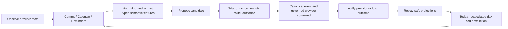

# Change Order 001: Five-surface executive loop

Status: **APPROVED 2026-08-06 — IMPLEMENTED, VALIDATED, AND DEPLOYED IN OBSERVATION; MAIN MERGE PENDING**

Date: 2026-08-06

Target branch after approval: `codex/administrateme-v2-runtime`, reconciled
non-destructively with current `main`

Affected member surfaces: **Today, Triage, Comms, Reminders, Calendar**

Constitutional classification:

- **PRESERVE** the closed executive-function loop, typed domain boundaries,
  event-log authority, member isolation, observation, governance, and pinned
  OpenClaw boundary.
- **MODERNIZE** the five read compositions, cross-surface navigation,
  deterministic attention rules, and production portal interaction model.
- **SUPERSEDE** unread-as-Focus, all-day-context-as-next-event, raw reminder
  recomposition in Today, browser-prompt Triage/cue enrichment, and an always
  open chat rail on dense work surfaces.
- **DEFER** no required product function. Optional provider activation remains
  governed by the existing provider/live-evidence gates.

Principal approval was recorded on 2026-08-06 and authorizes the scoped code,
review, test, and deployment workflow in section 12. It does not authorize real
provider writes, disabling observation mode, optional-provider activation, or
work on the remaining five navigation surfaces.

## 1. Executive decision

The five surfaces must behave as one deterministic executive-function loop,
not five adjacent dashboards:

The member should be able to answer five different questions without
remembering how data moved between systems:

| Surface | Primary question | It must not become |
|---|---|---|
| Today | What matters now, and what fits today? | A duplicate dump of every source record. |
| Triage | What proposed change needs my decision? | A second inbox or a raw observation queue. |
| Comms | Which conversations actually need attention? | An unread counter, model-ranked inbox, or second assistant transcript. |
| Reminders | What provider-owned reminder is active in this context? | A universal task model or copied reminder database. |
| Calendar | When is time occupied, pressured, or genuinely available? | A raw event list or automatic scheduler. |

## 2. Evidence-based audit

The audit used the live deployed portal, production JSON composition paths,
the current browser implementation, the projection/query code, Gate 7
acceptance, and the v2 constitutional documents.

### 2.1 Findings that are working and must be preserved

- All five routes are member-authorized, use the same Python composition root,
  and retain child/view-as restrictions.
- Today has a deterministic Day Brief and Carousel over typed item kinds.
- Triage is proposal-only; raw provider observations do not wait for approval.
- Comms composes account-bound Interaction facts at read time and preserves
  provider/account/workspace provenance.
- Reminders preserves Google Tasks and Apple Reminders capability ceilings and
  external authority.
- Calendar now has spatial Day/Week, six-week Month, Agenda, Find time, source
  visibility, capacity semantics, guardrails, buffers, and evidence.
- Provider mutations already pass guarded authorization, observation handling,
  optimistic concurrency, and terminal-result event seams.
- Material browser values use safe text assignment rather than untrusted HTML.

### 2.2 Live and code-level gaps

| Area | Evidence | Consequence |
|---|---|---|
| Today calendar semantics | The live “next on the clock” can be an all-day contextual event. `compose_daily_brief()` also labels the total schedule count as “timed events.” | Contextual facts displace executable time and misstate the day. |
| Today reminder composition | Today ranks raw open list items while Reminders separately enriches them with provider capability, activation bucket, cues, and explanations. | The same item behaves differently across tabs; exact provider actions and context are lost. |
| Reminder repetition | The live day showed repeated titles from separate provider lists as independent moves. They are distinct provider facts, but no read-only equivalence group carries that cognitive load. | Working memory sees repeated work without an explanation or review path. |
| Comms Focus | `_bucket()` treats unread inbound state as a sufficient Focus reason. The live account placed most visible threads in Focus, including receipts, automated notices, and operational alerts. | “Focus” becomes another unread inbox and fails the ADHD noise-filtering promise. |
| Comms/Today mismatch | Comms reports many needs-reply threads while Today reports no actionable messages because the two surfaces use different predicates and projected fields. | The member cannot trust which surface reflects communication obligations. |
| Message normalization | At least one live body preview exposes encoded HTML entities as literal text; quoted/noisy provider bodies dominate previews. | Scanning cost rises and the interface looks unreliable even though rendering remains safely escaped. |
| Extraction coverage | The generic `triage.item.proposed` schema supports task, commitment, calendar, reminder, list, list-item, and party-identifier candidates, but the live message pipeline automatically produces only commitment proposals. | Actionable bills, dates, reminders, and list candidates can remain in Comms without reaching the human gate. |
| Triage interaction | Enrichment uses sequential `window.prompt()` dialogs and free-text provider/member/container identifiers. | Routing is hard to understand, inaccessible, error-prone, and disconnected from approved destination directories. |
| Triage loop closure | The main surface shows only pending rows. It does not expose a concise recent-decision/provider-result trail or a direct return to the source thread. | After confirmation, the member must remember what happened and where to verify it. |
| Reminders interaction | Context-cue creation also uses prompt chains. “Now” may be dominated by overdue items without separating due-today, cue-matched, provider-important, and stale-review reasons. | Context features increase decision load instead of reducing it. |
| Cross-surface routing | Today message actions open generic CoS chat; source items do not consistently deep-link to their exact Comms thread, Reminder, Calendar event, or Triage candidate. | The member repeatedly searches for context the system already has. |
| Shared shell | At common laptop/desktop widths, the empty OpenClaw chat rail consumes 23 rem on Today, Triage, Comms, and Reminders; Calendar already collapses it. The member avatar is a button without an action. | Primary workspaces are compressed and one control presents a false affordance. |
| Observation state | Action-capable surfaces show a small “Observation mode” pill, not the required persistent explanation and link to would-have-happened records. | The user cannot predict whether a button will affect a provider. |
| State/freshness | The five surfaces do not consistently expose source watermark, stale/degraded reason, safe remaining functions, or reconciliation state in their working views. | Empty, quiet, stale, and disconnected can look equivalent. |
| View state | Calendar has URL-addressable view/date state; Today, Comms, Reminders, and Triage filters/selections are client-only. | Back/forward, refresh, bookmarks, and exact cross-surface links lose context. |

## 3. Design translation from multi-calendar research

The Calendar research established patterns that generalize without copying a
calendar metaphor onto every domain:

1. **Multiple bounded views over one truth.** A lens changes presentation, not
   source facts, authorization, or downstream reasoning.
2. **Source identity remains visible.** Combined views never erase provider,
   account, workspace, list, calendar, or member scope.
3. **Visibility is separate from effect.** Hidden or filtered records can still
   participate in deterministic capacity, attention, routing, and outcomes.
4. **Stable navigation carries orientation.** Current view, filters, selection,
   and anchor are addressable and survive refresh/back/forward.
5. **Frequent browsing is separated from consequential configuration.** Daily
   work leads; routing rules, provider truth, and advanced configuration are
   progressively disclosed.
6. **Preview precedes change.** The member sees target, effect, conflicts,
   authority, and provider capability before approval.
7. **One item at a time remains available.** Dense master/detail and ADHD
   single-item modes use the same deterministic records.
8. **Color supports but never carries meaning alone.** Text, icon, status, and
   explanation remain available to keyboard and assistive technology.

## 4. Scope of work

### Workstream A — Shared five-surface interaction contract (P0)

Create versioned, read-only presentation DTOs used by every surface:

- `SurfaceLinkV1`: typed object kind/id, destination route, source route, and
  permitted return path.
- `AttentionExplanationV1`: fixed rule id, human explanation, contributing
  typed fields, freshness, and evidence event ids.
- `ProviderActionStateV1`: unavailable, review-required, observation-suppressed,
  pending, confirmed, failed, reconciled, or conflicted.
- `SurfaceFreshnessV1`: projection watermark, provider last-success time,
  degraded reason, and safe remaining functions.

These are disposable read contracts, not events, projections, or a new
universal domain object. Every record retains its real kind and source of truth.

Add URL-backed view state:

- Today: `?view=brief|carousel&item=<typed-ref>`
- Triage: `?lens=ready|needs-details|recent&kind=<kind>&item=<proposal-id>`
- Comms: `?lens=focus|waiting|snoozed|quieted|all&account=<id>&thread=<key>`
- Reminders: `?lens=now|scheduled|places|anytime|completed&account=<id>&list=<id>&item=<id>`
- Calendar: preserve the existing `view` and `date`; add optional selected
  event and source-filter query state only where the URL remains privacy-safe.

Query state may change the display. It may not change capacity, priority,
provider truth, authorization, or write routing.

### Workstream B — Deterministic communication attention and extraction (P0)

Replace unread-as-Focus with an explicit deterministic attention policy.

Semantic features may be extracted by a schema-bound skill through the pinned
OpenClaw `llm-task` seam, but the skill may only report bounded features and
candidate fields. It may not select a lens, score a thread, choose a route, or
write state.

Required typed features include:

- reply explicitly requested / no reply requested / unknown;
- sender class and resolved Party reference where available;
- deadline/date/time/location spans with source offsets;
- transactional due, receipt/confirmation, security code, automated system
  notice, promotional/noise, and person-to-person flags;
- possible task, commitment, calendar, reminder/list, and identity candidates;
- confidence, skill/version/model provenance, and defensive-default reason.

Deterministic rules then decide:

- Focus only for an explicit attention signal such as required reply, member
  rule, provider-important plus a qualifying semantic feature, due/urgent
  candidate, or pending Triage link.
- Waiting only when the latest relevant message is outbound and no newer
  inbound reply exists.
- Snoozed and Quieted only from event-sourced member state or fixed approved
  rules.
- Unread remains a visual state, never a sufficient priority decision.
- Low-confidence or failed extraction remains visible in All and may request
  review; it does not silently become noise or Focus.
- Temporary security codes use a fixed sensitive-preview/expiry policy and do
  not linger in Focus after usefulness expires.

Normalize provider text safely before projection display: MIME/plain-text
selection, one safe HTML-entity decode, bounded quote/signature collapse, and
no `innerHTML` rendering.

Emit zero or more idempotent `triage.item.proposed` events only after schema,
scope, sensitivity, source evidence, and deterministic eligibility validation.
Do not duplicate the existing commitment path; reconcile or upcast it behind
compatibility tests.

### Workstream C — Triage as the universal proposal review cockpit (P0)

Replace the marketing-first/flat queue and prompt dialogs with a compact
master/detail review workspace:

- **Ready:** complete proposal with a valid reviewed destination.
- **Needs details:** missing target, member, time, Party, provider, or container.
- **Recent:** bounded confirmed/dismissed/failed/reconciled outcomes for loop
  closure; raw source observations remain excluded.
- Filters by proposed kind and source account, with calm counts.
- One-candidate mode for the ADHD profile and dense list mode for compressed
  profiles, both over the same rows.

The detail/review pane must show before confirmation:

- source excerpt and direct “open source” link;
- candidate type and fields, confidence, exact evidence spans, transformation
  and skill provenance;
- destination member/provider/account/calendar/list selected from authorized
  directories, never free-text ids;
- materialized canonical object and external action that will occur;
- provider capability, observation consequence, approval requirements, expiry,
  duplicate/collision warning, and current freshness;
- for calendar candidates, deterministic conflict/buffer/guardrail preview from
  the same Calendar reasoning contract;
- for reminder/list candidates, provider-native field and capability preview;
- for commitments, resolved Party and obligation direction.

Use labeled fields, inline validation, explicit review summary, cancel, and one
final Confirm action. No browser prompt is permitted. Approval remains
idempotent and must display pending, suppressed, confirmed, failed, and
reconciled terminal outcomes.

### Workstream D — One effective Reminders contract for Reminders and Today (P0)

Extract a pure `effective reminder item` composer from the existing Reminders
cockpit and make Reminders, Today, What Now, and the pinned OpenClaw dashboard
consume it. Preserve provider/list/item/revision identity and distinct list-item
semantics.

Required changes:

- Exact provider capabilities determine edit/complete/move actions everywhere;
  Today must not use a provider-name shortcut.
- Date-only Google scheduling and zoned/floating Apple dates render identically
  across surfaces without local-date drift.
- Now groups explain **cue matched**, **due today**, **overdue**, and
  **provider important** separately.
- Add a bounded stale-review group for repeatedly overdue items without
  changing their provider status.
- Add deterministic read-only possible-copy clusters using strict normalized
  fields. Every provider item remains visible in detail; no record is merged,
  deleted, completed, or suppressed without explicit member action.
- A possible-copy cluster becomes one Today attention card with an “inspect
  copies” action, not multiple indistinguishable next moves.
- Replace prompt-based context cue creation with an accessible rule builder that
  shows supported signal sources, latest freshness, operator, expected value,
  expiry behavior, and a deterministic preview.
- Move Quick Add behind a compact primary action/drawer. Show exact account,
  list, supported fields, observation result, and independent approval before
  command submission.

### Workstream E — Today as the cross-surface day operating system (P0)

Rebuild Today from the shared effective Calendar, Reminders, Comms, Triage,
Task, Commitment, Recurrence, and Routine contracts without collapsing kinds.

The first viewport should answer:

- where the member is in the day;
- the next real timed commitment or active guardrail;
- one recommended executable move;
- whether any human decision or communication response is genuinely pending;
- whether source freshness or observation changes what actions mean.

Required corrections and layout:

- Split timed events, all-day facts, and contextual calendar facts. Context and
  ignore events can inform the brief but cannot become “next on the clock.”
- Counts use truthful labels (`timed`, `all-day/context`, `moves`, `messages`,
  `decisions`) rather than counting every calendar fact as timed.
- The What Now guard accepts only an in-progress or next-30-minute timed event
  with a qualifying approved capacity effect; otherwise it uses the
  deterministic executable-work ranker.
- Day Brief groups **Now**, **Later today**, **Decisions**, and **Messages** with
  progressive disclosure for lower-salience context.
- Carousel keeps one item at a time and receives exact capability/actions from
  the shared contracts.
- Message actions open the exact Comms thread; question actions open the exact
  Triage candidate; reminder actions open the exact provider item; event actions
  open the exact Calendar date/event.
- Existing outcome commands remain type-specific. A calendar attendance action
  cannot complete a Task; a list-item completion cannot fulfill a Commitment;
  `Later` remains view-only.
- Direct provider changes from Today use the same explicit action review and
  reconciliation UI as their source surface.

### Workstream F — Calendar cross-functionality refinement (P1)

Preserve the reviewed Calendar redesign and its
`deterministic-household-calendar-v1` reasoning contract. Add only loop-closing
integration:

- Detail links to the source Comms thread, Triage decision, Reminder/Task, or
  Commitment when an explicit typed link exists.
- Triage calendar previews use the same effective-event/conflict code and
  reviewed write destinations.
- Today deep links open the correct anchored Day/Week and selected event.
- Multi-day context facts use a bounded spanning treatment so they remain
  visible without repeating as independent daily obligations.
- Calendar shows provider pending/confirmed/failed reconciliation for a
  reviewed candidate without pretending a requested write has completed.
- Keep source visibility presentation-only; cross-surface links and selected
  event state do not affect capacity.

Persistent or context-triggered calendar sets, people lanes, and automatic
rescheduling remain outside this change order. They require a separate typed
member-preference design and must never be model-inferred.

### Workstream G — Shared shell, responsive behavior, and accessibility (P0)

- Collapse OpenClaw chat to a clearly labeled floating action/drawer by default
  on all five dense workspaces at widths below 1600 px. Opening it is an explicit
  member choice; Comms never visually merges human communications with CoS chat.
- Replace the nonfunctional member avatar button with either a truthful identity
  indicator or an accessible menu/link with an implemented action.
- Replace oversized explanatory heroes with compact context headers. Put the
  active queue/grid/timeline within the first viewport while retaining calm,
  guilt-free copy.
- Standardize command bars, view switches, source filters, count semantics,
  master/detail panes, empty states, evidence, and action receipts.
- Add the required persistent observation banner to every action-capable
  surface. It explains suppression, the trust period, safe local actions, and
  links to would-have-happened records.
- Render loading, empty, disabled, never-configured, stale,
  degraded-but-readable, held-for-review, observation-suppressed, unauthorized,
  offline, conflict, retryable error, and healthy states distinctly.
- Meet WCAG 2.2 AA for keyboard navigation, focus return, labeled groups,
  status/live regions, field errors, touch targets, contrast, reduced motion,
  200% zoom, and mobile reflow.
- Do not use native prompt/confirm dialogs for domain workflows.

### Workstream H — Constitutional alignment, evidence, and operations (P0)

Amend in the same reviewed implementation PR:

- `PRODUCT-THESIS-AND-DOMAIN-MAP.md`: clarify how the five surfaces divide the
  eight loop stages and reuse effective read contracts.
- `UX-BEHAVIOR-CONTRACT.md`: add UX-24 through UX-29 for shared links,
  attention rules, Triage routing, effective reminders, observation/freshness,
  and URL-addressable state.
- `GATE-7-EXPERIENCE.md`: replace the five independent-surface description with
  the closed member loop.
- `CONSTITUTIONAL-CROSSWALK.md`: add C101 for five-surface loop coherence.
- `MIGRATION-MAP.md`: classify the superseded read compositions and prompt
  workflows.
- `ACCEPTANCE-CONTRACT.md`: add AC-28 as a production-composition process gate.
- `HANDOFF.md`: record implementation, tests, live boundaries, and rollback.
- Gate 7 browser evidence: desktop/tablet/phone/reduced-motion captures plus a
  cross-surface interaction transcript and zero-error console/network report.

## 5. Required implementation sequence

1. **Contract and fixture gate**
   - Add failing pure/unit/process/browser tests for the live audit findings.
   - Pin typed presentation DTOs and semantic-feature schema.
2. **Shared composition gate**
   - Build effective Reminder and shared cross-surface link/freshness contracts.
   - Correct Today calendar semantics and exact provider actions.
3. **Communication gate**
   - Add safe message normalization, semantic-feature events, deterministic
     attention v2, and compatibility/upcast behavior.
4. **Triage gate**
   - Complete multi-target candidate production, destination directories,
     lifecycle/outcome reads, and accessible review UI.
5. **Surface interaction gate**
   - Rebuild Today, Comms, Reminders, and Calendar cross-links and URL state;
     apply the shared compact/responsive shell.
6. **Closed-loop gate**
   - Prove source message -> candidate -> Triage enrichment -> confirmation ->
     canonical/provider request -> observed terminal outcome -> Today
     recalculation through the production composition root.
7. **Release gate**
   - Complete constitutional sync, replay/migration/isolation/security checks,
     browser visual review, backup, reviewed merge, immutable upgrade, Doctor,
     and observation-mode live simulation.

No partial surface is deployed before the shared contract and closed-loop
process gates pass.

## 6. Acceptance criteria

| ID | Required executable outcome |
|---|---|
| CO-01 | Today never labels all-day/context facts as timed and never selects one as the next timed commitment. |
| CO-02 | Today and Reminders return the same provider identity, activation reason, capability, and completion contract for a given list item. |
| CO-03 | Today and Comms use the same deterministic actionable-message predicate and explanation inputs. |
| CO-04 | Unread alone cannot place a thread in Focus; low-confidence failure remains visible and explained without becoming noise. |
| CO-05 | A credential-free inbound fixture can produce task, commitment, calendar, reminder/list, or identity candidates only as schema-valid Triage proposals; none writes canonical/provider state before confirmation. |
| CO-06 | Triage uses authorized destination choices and inline validation; no prompt dialog or free-text provider/container id is reachable. |
| CO-07 | Calendar-candidate review shows deterministic conflicts, buffers, guardrails, destination, and observation effect before confirmation. |
| CO-08 | Possible reminder copies render as a transparent read-only group while every source item, revision, list, and action remains independently inspectable. |
| CO-09 | Every Today attention card deep-links to the exact source surface and preserves view/selection through refresh and browser history. |
| CO-10 | Requested, observation-suppressed, provider-confirmed, failed, and reconciled writes render distinctly and are linked to immutable evidence. |
| CO-11 | Every action-capable surface has a truthful observation/freshness state; empty, stale, disabled, and healthy are not interchangeable. |
| CO-12 | Member/account/workspace/list/calendar scope survives combined views; child, device, cross-member, and view-as mutations remain denied server-side. |
| CO-13 | No model ranks, routes, authorizes, schedules, sends, completes, suppresses, or mutates. Every skill call remains schema-bound through pinned OpenClaw with provenance. |
| CO-14 | Replay from event zero, migration from the current live schema, restart idempotency, duplicate delivery, and stale-command conflicts produce equivalent scoped state. |
| CO-15 | The five surfaces pass keyboard, screen-reader semantics, reduced-motion, 200% zoom, 1440/1280/1024/820/390 widths, and produce zero unexpected page/console/request errors. |
| CO-16 | The production live simulation closes one observation-mode source-to-outcome-to-recalculated-Today loop without an external provider mutation. |

## 7. Test and review requirements

At minimum, implementation adds or updates:

- pure unit suites for Today, Comms attention v2, effective Reminders,
  candidate eligibility, destination validation, and cross-surface links;
- projection migration/replay tests for any new event fields or lifecycle reads;
- pipeline tests for low-confidence, model unavailable, malformed output,
  privileged input, duplicate delivery, and multi-candidate input;
- API tests for member/account/list/calendar isolation, URL/query bounds,
  observation, governance ordering, optimistic concurrency, and result states;
- one AC-28 five-surface production-composition process test;
- Gate 7 browser interactions for all five views, deep links, browser history,
  structured Triage/cue forms, chat drawer, state banners, and responsive layout;
- current full Python, acceptance `--runxfail`, Ruff, mypy, invariant, OpenClaw,
  adapter, bridge, pack, replay, backup, and release-candidate gates.

Release claims must include the exact test counts and any environment-specific
skip/failure verbatim.

## 8. Data, migration, privacy, and rollback

- Additive event schemas/upcasters only; never rewrite or delete existing facts.
- Existing Calendar/Interaction/List identities remain stable.
- New read-only groups or links are deterministically rebuilt from source facts
  and explicit member decisions.
- Privileged communication content remains excluded from model/vector/cross-owner
  processing under existing rules.
- No household identity, address, account id, message content, or provider token
  enters code, fixtures, screenshots committed as general product evidence, or
  documentation.
- Before live upgrade: authenticated backup, compatibility check, service
  quiescence, immutable release copy, Doctor, canonical round trip, and rollback
  pointer.
- Observation mode remains active unless the principal separately authorizes a
  mode change after reviewing would-have-happened evidence.

## 9. Explicit exclusions

This change order does not include:

- redesign of People, Knowledge, Finance, Scoreboard, or Settings;
- activation of Outlook, iMessage/BlueBubbles, Twilio SMS, WhatsApp, Apple
  EventKit, or other optional providers not already authorized;
- auto-send, auto-confirm, auto-schedule, auto-reschedule, or automatic reminder
  promotion/conversion;
- a new projection, universal work object, workflow engine, scheduler, Node
  application runtime, provider SDK, model router, or AdministrateMe transcript;
- model-inferred priorities, routes, relationships, locations, completion, or
  attendance;
- persistent/context-triggered calendar sets or people-lane scheduling;
- disabling observation mode or performing real external writes during the
  implementation simulation.

## 10. Files expected to change after approval

Likely implementation paths include:

- `adminme/today.py`, `adminme/comms.py`, `adminme/reminders.py`,
  `adminme/calendar.py`, and a small shared presentation-contract module;
- member surface composition/API code under `adminme/products/member/`;
- Interaction, Triage, and Lists projection schemas/handlers/queries only where
  additive lifecycle/read support is required;
- typed event schemas and the existing reactive pipeline/skill packs;
- `adminme/products/member/assets/member.js`, `member.css`, and `index.html`;
- production-composition, projection, pipeline, adapter, accessibility, and
  browser evidence tests;
- the constitutional/evidence documents named in Workstream H;
- the pinned OpenClaw dashboard binding only if its read contract must advance
  to the same version as the member portal.

## 11. Definition of done

The change is complete only when:

1. every CO-01–CO-16 criterion passes through production composition;
2. one representative event closes the full observe-to-outcome-to-next-action
   loop under observation mode;
3. the five member surfaces and pinned OpenClaw reads consume compatible
   versioned contracts;
4. event replay, privacy/isolation, approval ordering, and provider authority
   are unchanged or strengthened;
5. browser and accessibility evidence demonstrates the intended working-memory
   reduction at all supported widths;
6. constitutional crosswalk, migration, acceptance, handoff, and retained
   evidence agree with executable behavior;
7. the reviewed commit is merged before the family Mac receives the immutable
   upgrade; and
8. Doctor, backup, rollback, and live observation-mode simulation pass after
   deployment.

## 12. Approval boundary

Approval of this change order authorizes the scoped implementation and
review/test/deployment workflow above. It does **not** authorize real outbound
provider writes, observation-mode exit, optional-provider activation, or work
on the remaining five navigation surfaces.

## 13. Implementation record

The approved implementation preserves the constitutional type boundaries and
adds no projection, runtime, provider SDK, scheduler, universal work object, or
model router.

| Scope | Executable implementation |
|---|---|
| Shared read contracts | `adminme/surface_contracts.py` supplies exact typed deep links, attention explanations, provider-action presentation state, and freshness state. These DTOs are disposable and non-authorizing. |
| Today | `deterministic-daily-brief-v2` separates timed schedule from all-day/context facts, consumes the effective reminder contract, and uses the same message-attention inputs as Comms. |
| Comms | `deterministic-comms-cockpit-v2` makes unread presentation-only, safely normalizes transport entities/quoted noise, expires temporary-code attention after 15 minutes, and derives Focus from fixed typed signals including linked Triage candidates. |
| Reminders | `compose_effective_reminders()` is shared by Reminders and Today; strict possible-copy clusters preserve every provider item and expose exact provider actions. |
| Triage | Structured authorized destination selectors, readiness validation, recent outcomes, exact source links, and deterministic Calendar previews replace browser prompt workflows. |
| Calendar | `preview_calendar_candidate()` runs the reviewed candidate through the existing `deterministic-household-calendar-v1` effective-event, conflict, buffer, guardrail, and write-destination reasoning. |
| NLP seam | The existing `classify_message_nature` skill advances to 4.0.0 through pinned OpenClaw after the live extraction repair. It reports bounded semantic features and verbatim-evidence candidates only; fixed pipeline code decides eligibility, rejects absent source quotes, strips every target field outside the closed allowlist, requires exact private member scope, deduplicates overlapping evidence, and emits human-gated proposals. Confidence is display evidence and never an eligibility threshold. |
| Projection migration | Interactions v4 adds semantic feature/provenance columns and the `messaging.semantic_features_extracted` handler additively; replay preserves every raw source event. |
| Browser | The five surfaces have URL-backed view/selection state, persistent observation/freshness presentation, structured dialogs, and a chat drawer below 1600 px. No domain workflow calls `window.prompt`, `window.confirm`, or `window.alert`. |

AC-28 is implemented in
`tests/acceptance/test_gate7_household_experience.py` and is supported by the
pure, projection, pipeline, migration, security, and browser suites named in
`ACCEPTANCE-CONTRACT.md`. Final release counts, live Doctor state, immutable
deployment identity, and observation-mode browser simulation are recorded in
`HANDOFF.md`; a real provider mutation remains explicitly out of scope.

## 14. Live observation activation record

The family Mac activated immutable revision
`eeec1a4bd8ef6955636871ff7cc75a41a571fc73` from the reviewed v2 branch on
2026-08-06. The final authenticated pre-switch backup is
`administrateme-20260806T224346Z.ambackup`; the release pointer retains the
prior immutable revision for rollback. Observation remains active and no live
provider mutation was authorized or performed.

The activation rehearsal exposed one release-coherence defect in the upgrader:
its post-switch Doctor could retain the retiring interpreter's schema registry
while inspecting a new release. The upgrader now launches Doctor with the
candidate release interpreter and an explicit instance/OpenClaw/PATH
environment. A deliberately failed intermediate activation proved automatic
rollback before the repaired candidate and final surface revisions passed the
same fail-closed switch.

Independent operator status and full Doctor after activation reported healthy
loopback services, the exact reviewed OpenClaw `2026.7.2` commit, 14/14 healthy
projection checkpoints, 5/5 reconciled managed jobs, a successful canonical
synthetic round trip, zero external side effects, and observation-only runtime
state. Live browser simulation then exercised Today, Triage, Comms, Reminders,
and Calendar at 911 px and 390 px. Every route retained exact active
navigation, observation and freshness state, a collapsed CoS drawer, no
degraded banner, no document-level horizontal overflow, and zero browser
warnings/errors. The simulation performed view/filter/selection navigation
only; it did not confirm, send, complete, or write.
