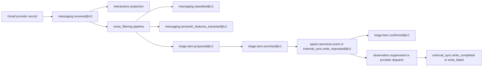

# CO-007 — Trustworthy member intent, extraction, Triage, and SSOT commitment

Status: **APPROVED; PHASE-A CANDIDATE IMPLEMENTED — PHASE-B DEPLOYMENT AND REAL PROVIDER EFFECTS NOT AUTHORIZED**

Date: 2026-08-08

Implementation branch: `codex/administrateme-v2-runtime`, reconciled
non-destructively with current `main`

Affected member surfaces: **shared shell, Today, Triage, Comms, Reminders,
Calendar, People, Notes, Settings, and the OpenClaw member-chat relay**

## 1. Executive decision

AdministrateMe needs one dependable way for a member to externalize a thought
without first deciding whether it is a task, commitment, calendar event,
reminder, list item, recurrence, or relationship fact. That convenience must
not recreate the retired generic Quick Capture product, turn Notes into a
command channel, or let a model decide what becomes household truth.

The implemented member action is **Add for review**. It records the member's exact
text as an immutable, non-canonical intent fact and immediately makes it
visible in Triage. An optional schema-bound language pass may extract one or
more typed candidates. Deterministic validators, member scope, provider
capabilities, destination policy, and the human gate decide whether a
candidate is ready. No task, commitment, recurrence, calendar write, reminder
write, list write, or relationship fact becomes canonical merely because the
member typed or dictated a sentence.

Explicit domain controls remain distinct. For example, an adult who selects a
specific provider account, list, operation, and exact content in Reminders may
request that provider action directly. That is not language extraction. It
still requires domain authorization, a server-verified independent OpenClaw
approval receipt, privacy/content validation, rate limiting, observation-mode
handling, and a terminal result event.

```mermaid
flowchart LR
    A["Provider or member observation"] --> B["Immutable source event"]
    B --> C["Schema-bound NLP features"]
    C --> D["Deterministic candidate rules"]
    D --> E["Triage proposal or Needs interpretation"]
    E --> F["Member enriches and confirms"]
    F --> G["Typed canonical event or governed provider command"]
    G --> H["Observed or suppressed terminal result"]
    H --> I["Replay-safe projections and Today recalculation"]
```



The language model is a replaceable parser at step C. It may return bounded
fields and evidence spans. It may not choose eligibility, ownership, privacy,
priority, routing, authorization, deduplication, materialization, or whether a
provider write executes.

## 2. Constitutional basis

This change order reconciles the live and executable behavior against:

- `ADR-0000-CONSTITUTIONAL-RECONCILIATION.md`: immutable event authority,
  deterministic projections, typed domain separation, and retirement of the
  generic Quick Capture and central voice-ingest concepts;
- `PRODUCT-THESIS-AND-DOMAIN-MAP.md`: the eight-stage closed loop, all six
  product functions, the thirteen domain projections plus derived Triage, and
  schema-bound NLP followed by deterministic eligibility;
- `ADR-0001-OPENCLAW-ADMINISTRATEME-BOUNDARY.md`: OpenClaw ownership of
  conversations, model routing, and generic approval; AdministrateMe ownership
  of household truth, scope, domain authorization, proposals, and outcomes;
- `UX-BEHAVIOR-CONTRACT.md`: Triage as the only cross-domain proposal gate,
  explicit state/freshness, no false healthy empty state, provider-aware
  writes, and no Notes command prefix or central voice recorder;
- `ACCEPTANCE-CONTRACT.md`: durable bus and poison behavior, adapter cursor
  discipline, independent approvals, observation outcomes, exact OpenClaw
  compatibility, health truth, member chat, Triage, Comms, Reminders, and the
  five-surface closed loop;
- `BOOTSTRAP-AND-TOPOLOGY-CONTRACT.md`, `GATE-6-ARCHITECTURE.md`, and
  `GATE-7-EXPERIENCE.md`: one central Python runtime, one exactly pinned
  OpenClaw Gateway, separate member bridges, and process-level proof through
  the production composition root;
- CO-001, CO-004, CO-005, the constitutional crosswalk, migration map, and
  handoff: prior accepted behavior remains evidence, but a passing fixture or
  status claim is not proof when current code or live behavior contradicts it.

This proposal preserves all six product functions, all thirteen domain
projection capabilities plus derived Triage, all five adapter categories, all
six pack kinds, all five built-in profiles, and all four built-in personas.

## 3. Audit evidence and conclusions

The audit combined the current live Tailscale-served member portal, an existing
signed-in Gmail stream, source inspection, event/bus state, projection state,
and the current acceptance fixtures. The live tests used uniquely tagged,
non-household test content and left observation mode enabled.

### 3.1 What is structurally sound and must be preserved

- The encrypted event log is the append-only source of truth; the durable bus
  delivers events to deterministic projections and pipelines.
- Triage already materializes distinct task, commitment, recurrence,
  calendar-event, reminder, list, list-item, and People/relationship targets
  through a closed allowlist.
- Triage confirmation uses optimistic concurrency, idempotency fingerprints,
  event causation, governance checks, and replay-safe resolution history.
- Raw source observations remain in their source projections. Triage contains
  derived proposals rather than every email, calendar record, or reminder.
- Calendar destinations, provider accounts, member routes, and provider
  capabilities are validated by server-side code before a routed write.
- Observation mode suppresses the final provider effect and records a terminal
  result instead of pretending the provider changed.
- OpenClaw is exact-version pinned and all model work crosses the `llm-task`
  seam rather than a provider SDK in AdministrateMe.

### 3.2 Live failures

| Finding | Direct evidence | Consequence |
|---|---|---|
| Triage displayed `Healthy Empty` with no source watermark and no Triage bus checkpoint. | Live portal and subscriber status. | Empty, unprocessed, stalled, and genuinely quiet are visually indistinguishable. |
| Dashboard member chat accepted text, then `chat.send` failed with `INVALID_REQUEST: system provenance fields require admin scope`. | Two live sends and gateway error output. | The primary natural-language entry point acknowledges input it cannot deliver. |
| Settings reported OpenClaw healthy while chat sends failed. | Live Settings and member-chat result. | Integration health is being inferred from configuration/handshake rather than the exercised capability. |
| Four tagged Gmail messages representing a task, calendar event, recurrence, and commitment appeared in Gmail but never appeared in Comms or Triage. | Signed-in Gmail stream and portal inspection. | Automatic event identification is not reliable enough to support the intended executive-function loop. |
| Gmail entered `backoff` with `api_changed`, repeatedly emitted one older `messaging.received`, and never advanced to the tagged test messages. | Adapter status and event-log sequence. | A failing message or provider response can create head-of-line replay and conceal later facts. |
| Noise filtering and identity resolution degraded after five failures with a poison event and no advancing checkpoint. | Durable bus subscriber state. | Later messages cannot reach classification or Triage even though other pipelines continue replaying the same source event. |
| Commitment and thank-you pipelines repeatedly checkpointed the replayed Gmail event and emitted defensive suppression events. | Event-log and bus state. | Idempotency prevents some duplicate truth, but repeated work and misleading activity remain possible. |
| A typed Reminder quick-add produced `external_sync.write_requested`, `observation.suppressed`, and `external_sync.write_completed`; the provider was not changed. | Live observation-mode test. | The terminal result spine works, but the approval and audit linkage on the request path is unsound. |

### 3.3 Executable code gaps

| Gap | Current implementation | Required correction |
|---|---|---|
| Client-forged approval | `member.js` sends `openclaw_approved: true`; Python accepts the boolean as independent approval for Reminders and Comms. The plugin also manufactures the boolean for review. | Remove every client-supplied approval boolean. Accept only a server-verified, signed, content-bound, expiring, single-use OpenClaw approval receipt. |
| Missing independent approval in Triage writes | Triage confirmation can materialize `external_sync.write_requested` after domain governance without a verifiable OpenClaw approval artifact. | Split confirm into domain approval and independently approved provider execution. Local canonical events need domain authorization; external commands additionally require the receipt. |
| Narrow member-chat action schema | `administrateme_action` and `ActionRequest` accept only `task` or `commitment`; `capture` can write canonical truth directly when observation is off. | Replace ambiguous direct capture with proposal-only member intent. Keep direct mutation only in exact, typed domain commands. |
| Incomplete message extraction | The generic candidate allowlist accepts task, calendar event, reminder, list, list item, and party identifier, but not recurrence; commitments are handled in a separate pipeline. | Define one versioned candidate vocabulary and deterministic arbitration across all supported types without collapsing their canonical models. |
| Threshold as silent deletion | Generic candidates below confidence `0.65` are discarded rather than represented as needing interpretation. | Confidence may affect presentation only. Durable member intent and source evidence must not disappear because a model is uncertain. |
| Missing durable Gmail cursor use | The runtime provides `AdapterCursorStore`, but Gmail uses its own in-memory `_cursor` and advances only after the full fetched batch. | Claim a durable lease; read the persisted watermark; dedupe and acknowledge each message; advance a page watermark only after every prior message is durably accepted or explicitly quarantined. |
| Pipeline health hard-coded | Runtime marks every registered reactive pipeline healthy without reading `PipelineRunner.status()` or bus state. | Derive health from subscriber checkpoint, lag, consecutive failures, poison id, last success/error, and required upstream capability. |
| Chat contract proof is fixture-only | Acceptance validates deterministic transport and local request shapes, not a real `chat.send` against the exact pinned gateway source. | Add a source-pinned protocol contract test and a process test using the real local gateway with no model/provider secret exposure. |
| Incomplete audit chain | Observation suppression does not receive the initiating command's causation id, and the generic helper emits household-shared scope even for private content. | Carry correlation, causation, owner, visibility, sensitivity, command id, and approval receipt id through every outbound terminal event. Preserve the initiating scope. |
| Reversed confirmation chronology | Triage writes canonical materializations first, then appends `triage.item.confirmed` with the materialization as its cause. | Append a content-bound domain confirmation before any materialization, then append a separate materialization receipt. Effects must be caused by approval, never the reverse. |
| Readiness is computed only from fields | Triage `review_state` checks missing data but not live pipeline/adapter health or a source watermark. | Separate candidate completeness from source-processing health. Never label a queue healthy solely because it is empty. |

These findings supersede any handoff, migration-map, or change-order sentence
that presently describes the affected path as complete or healthy. Historical
records remain intact; implementation of this proposal must append explicit
amendments rather than rewrite prior evidence.

### 3.4 Current executable event path

The current event identifiers are meaningful and mostly reusable. The failure
is in their coverage, ordering, and runtime wiring:



At present, Gmail can fail before it accounts for and durably advances the
whole history batch; N can stop at a poison event; recurrence is not in N's
generic candidate allowlist; low-confidence candidates vanish; X precedes Q;
and external commands do not carry independently verifiable approval ids. A
typed direct Reminder/Comms action enters at X after a browser-supplied approval
boolean. Member chat is a separate OpenClaw conversation path and currently
fails at live `chat.send` before it can invoke the proposal tool.

## 4. Member experience decision

### 4.1 Shared-shell action: Add for review

Every authorized adult member surface gets one consistent, accessible **Add
for review** action. It opens a small drawer with:

1. one focused text field, compatible with operating-system dictation;
2. optional recognition-first type hints: **Do**, **Promise**, **Time**,
   **Reminder/List**, **Repeat**, and **Person/Fact**;
3. one primary button: **Save for review**;
4. a short explanation: “This saves your thought in Triage. Nothing becomes
   official or changes another app until you confirm it.”

The type hint is optional and never authoritative. It constrains which
deterministic validators may run; it does not authorize canonical truth. The
member is not required to supply a due date, provider, destination, person, or
RRULE during capture.

On success, the drawer closes and displays: **Saved for review. Nothing else
changed.** The new holding row must be durable and immediately visible under a
new Triage tab, **Needs interpretation**, even when OpenClaw or the language
skill is down. There is no silent spinner, optimistic false success, or lost
text.

This is not the retired Quick Capture product:

- it is a member-authenticated proposal input, not a universal data source;
- it does not create a generic canonical object;
- it cannot be activated by a Notes prefix;
- it stores no audio and introduces no central voice-ingest pipeline;
- it cannot bypass Triage for ambiguous language;
- it does not decide priority, urgency, destination, or schedule.

### 4.2 ADHD-supportive interaction rules

The interface must reduce working-memory demand without becoming persuasive or
making behavioral decisions for the member:

- **Externalize first:** only text is required; taxonomy is optional.
- **Recognition over recall:** show plain-language kinds and known destinations
  as choices instead of requesting identifiers.
- **Progressive disclosure:** ask only for the fields that the selected typed
  materializer requires.
- **Visible resumption:** unfinished captures remain under Needs
  interpretation; they never disappear after refresh or model failure.
- **One decision at a time:** preserve the Triage master/detail workspace and
  select one candidate without forcing a bulk approval flow.
- **Calm copy:** use “Needs a detail” and “Saved for review,” not shame,
  overdue escalation, streak loss, or guilt language.
- **No invented urgency:** missing due dates, priority, energy, and effort stay
  null. A model cannot fill them from convention or plausibility.
- **No automatic merge:** possible duplicates may be shown together, but only
  deterministic exact fingerprints may suppress duplicate event creation and
  only a member can merge distinct household objects.
- **No interruption by default:** a captured thought enters Triage; it does not
  become an alert merely because it was just entered.

### 4.3 Triage information architecture

Triage becomes four explicit views:

| View | Meaning | Primary action |
|---|---|---|
| Needs interpretation | Durable member intent exists, but there is no valid typed candidate yet. | Choose a kind or wait/retry extraction. |
| Needs details | A typed candidate exists but required content, person, route, or destination is missing. | Supply only missing fields. |
| Ready | Candidate is complete and current, but still non-canonical and unapproved. | Review evidence and confirm. |
| Recent | Confirmed, dismissed, superseded, suppressed, failed, or observed outcomes. | Inspect evidence or return to source. |

Candidate completeness and processing health are displayed separately. An
empty Ready view may say “Nothing is ready,” but the surface header must also
state the last source watermark, Triage checkpoint, lag, and any degraded
upstream pipeline. `Healthy Empty` is forbidden unless all required subscribers
are current and at least one trustworthy source watermark exists.

### 4.4 Domain-specific direct actions

Direct Add/Create controls are permitted only when the member has already made
the semantic choice in a typed domain surface. Examples include creating a
reminder in a selected writable list or creating a calendar event in a
reviewed destination. The form must show the exact provider/account/container,
content preview, observation state, and expected result.

The default global path remains Add for review. A domain direct action may skip
Triage only if all of the following are true:

- the operation and target kind are explicit and allowlisted;
- the member is acting as self and the destination belongs to or is writable
  for that member;
- required fields pass deterministic validation;
- the request carries optimistic concurrency where an existing object is
  changed;
- domain governance passes;
- a separate OpenClaw approval receipt is verified for the exact content hash;
- the final privacy guard passes;
- observation mode and terminal audit are preserved.

Extracted provider facts and model-produced candidates can never use this
shortcut.

### 4.5 Source-surface affordances

Comms, Calendar, Reminders, People, and Notes may offer **Send to Triage** on a
specific visible fact. That action records the exact source event id and member
request; it does not copy the source object or reinterpret it in the browser.
Notes remains ingest/query-only: the action is an explicit member proposal,
not a command hidden in note content.

## 5. Event and schema design

All new events use the existing encrypted `EventEnvelope`. The envelope remains
the canonical provenance and ordering contract:

| Envelope field | Requirement for this path |
|---|---|
| `event_id` | Server-generated monotonic id; never supplied by the browser or model. |
| `event_at_ms`, `occurred_at`, `recorded_at` | Event ordering time, source occurrence time, and durable recording time remain distinct. |
| `tenant_id` | Resolved by the authenticated runtime. |
| `type`, `schema_version` | Registry-validated before append. New payloads start at v1; changed payloads get a new version and upcaster. |
| `source_adapter`, `source_account_id` | Exact member surface, adapter, or pipeline seam; never a generic “AI” source. |
| `owner_scope`, `visibility_scope`, `sensitivity` | Inherited from the member/source fact and preserved through extraction, Triage, commands, and outcomes. |
| `correlation_id` | One interaction/processing chain. |
| `causation_id` | Immediate prior event; required for extracted candidates, approval consumption, provider commands, suppression, and results. |
| `actor_identity` | Authenticated member or named internal component; no browser-asserted identity. |
| `idempotency_key` | Deterministic per tenant/member/request/candidate or provider message fingerprint. |
| `raw_ref` | Request hash or protected raw reference; never a secret, token, session credential, or unbounded model transcript. |
| `payload` | Registry-validated JSON object for the exact event type and schema version. |

### 5.1 New immutable member-intent fact

`triage.intent.submitted@v1` records exactly what the authenticated member asked
the system to hold for review. It is an explicit proposal-input fact, not a
task or other domain object. Raw provider observations still do not enter
Triage merely because they arrived.

```text
TriageIntentSubmittedV1
  intent_id: str[1..240]
  member_id: str[1..240]
  text: str[1..2000]
  source_surface: Literal[
    today, triage, comms, reminders, calendar,
    people, notes, finance, scoreboard, settings, openclaw
  ]
  kind_hint: TriageTargetKind | null
  source_event_id: str[1..240] | null
  submitted_at: aware datetime
  client_request_id: str[8..120]
```

Rules:

- `member_id`, scope, role, and source visibility come from the server session.
- `source_event_id`, when present, must resolve to an event visible to that
  member; the browser cannot link arbitrary evidence.
- exact retry with the same request hash returns the prior event; a different
  body under the same request id returns 409.
- privileged source facts never copy their content into a lower-sensitivity
  intent event.
- Triage projects this event immediately as `source_kind=member_intent`,
  `target_kind=null`, and `state=pending_interpretation`.

### 5.2 Versioned language-feature event

`triage.intent.features_extracted@v1` stores bounded parser output and evidence,
not a decision:

```text
TriageIntentFeaturesExtractedV1
  intent_id: str[1..240]
  source_event_id: str[1..240]
  skill_call_event_id: str[1..240]
  language: str[1..32] | null
  candidates: list[0..10] of
    candidate_key: str[1..120]
    target_kind: TriageTargetKind
    title: str[1..1000]
    fields: dict[str, JSON]              # sanitized by kind allowlist
    evidence_spans: list[0..20] of
      field: str[1..120]
      start: int >= 0
      end: int > start
    confidence: float[0..1] | null       # display/evidence only
    reasons: list[str[1..240], 0..20]
  extraction_state: Literal[complete, defensive_default, unavailable, invalid]
  extracted_at: aware datetime
```

The schema-bound OpenClaw skill may populate these fields. Post-processing must
reject unknown keys, invalid spans, overlong lists, route/provider claims,
member ids, priority decisions, approval flags, and canonical ids. Raw prompts,
provider secrets, and full unbounded model responses are forbidden.

### 5.3 Deterministic candidate proposal

Valid extracted candidates continue to become `triage.item.proposed`, but a v2
payload adds durable lineage without changing v1 history:

```text
TriageItemProposedV2
  proposal_id: str[1..240]
  parent_intent_id: str[1..240] | null
  candidate_key: str[1..120] | null
  target_kind: TriageTargetKind
  owner_member_id: str[1..240]
  title: str[1..1000]
  candidate: dict[str, JSON]
  route: TriageRouteV1 | null
  source_event_id: str[1..240]
  extraction_event_id: str[1..240] | null
  eligibility_rule_ids: list[str[1..120], 1..20]
  confidence: float[0..1] | null
  reasons: list[str[1..240], 0..20]
```

Deterministic code, not the model, decides whether each feature candidate is
eligible for this event. Confidence cannot authorize or silently discard a
member intent. If extraction fails or yields no eligible child candidate, the
parent intent remains visible under Needs interpretation.

One intent may produce multiple child proposals. Proposal ids are derived from
tenant-safe hashes of the parent intent id, candidate key, target kind, and
sanitized candidate fingerprint. Reprocessing the same extraction cannot
duplicate proposals.

### 5.4 Candidate vocabulary and field allowlists

The following types remain distinct:

| Candidate kind | Allowed extracted fields | Readiness controlled by deterministic code |
|---|---|---|
| `task` | description, due text/instant, energy, effort minutes | Title and owner; invalid dates remain missing. |
| `commitment` | kind, owed-to reference/evidence, due, urgency text, source interaction | A resolved owed-to Party is required; no person is guessed. |
| `calendar_event` | start, end, all-day, event type, location | Zoned start/end and reviewed writable route are required. |
| `reminder` | due, notes, priority as explicit source value only | Provider/account/list route and provider-specific validation are required. |
| `list` | notes | Exact provider/account capability is required. |
| `list_item` | due, notes, priority as explicit source value only | Provider/account/list route is required. |
| `recurrence` | recurrence text, kind, lead-time text, trackable intent, linked-object evidence | A deterministic recurrence parser must produce supported RRULE and next occurrence. |
| `party_identifier` | existing identity-candidate fields | Exact normalized value and surviving Party are required. |
| `party_candidate` | display name, person/organization evidence, identifiers | Member review is required; no auto-created Party from model confidence. |
| `party_relationship` | Party references, label, direction, since evidence | Both existing Parties and supported direction are required. |
| `relationship_fact` | Party reference, kind, label, value, effective date, evidence quote | Existing Party and allowlisted fact kind are required. |

Commitment-specific extraction may remain a dedicated pipeline for its richer
party resolution, but it must emit into the same Triage lineage contract and
must not race the generic pipeline into two proposals for the same source span.
A deterministic arbitration key owns that deduplication.

### 5.5 Recurrence is not scheduling

The model may return literal recurrence language and evidence spans. A pinned,
deterministic recurrence parser owns normalization to the supported RRULE
subset, timezone handling, and next-occurrence calculation. Unsupported or
ambiguous phrases remain Needs details. `recurrence.added` remains typed
household truth; it never becomes an OpenClaw cron job. Cron/background
execution remains OpenClaw-owned and requires a separate reviewed standing
order.

### 5.6 Immutable domain approval before materialization

The log must record the member's exact, current decision before any canonical
event or provider command is appended. Version the Triage decision and add a
separate materialization receipt:

```text
TriageItemConfirmedV2
  proposal_id: str[1..240]
  confirmed_at: aware datetime
  confirmed_by_member_id: str[1..240]
  expected_last_event_id: str[1..240]
  candidate_fingerprint: sha256-hex

TriageItemMaterializedV1
  proposal_id: str[1..240]
  confirmation_event_id: str[1..240]
  materialized_event_ids: list[str[1..240], 1..10]
  materialized_at: aware datetime
```

The atomic sequence is: validate current projection state, append
`triage.item.confirmed@v2`, append the allowlisted materialization batch with
that confirmation as causation, then append `triage.item.materialized@v1`.
Idempotent recovery may finish an incomplete materialization only when the
stored candidate fingerprint still matches exactly.

A direct typed domain control uses `member.provider_action.confirmed@v1`
instead of a Triage confirmation:

```text
MemberProviderActionConfirmedV1
  action_id: str[1..240]
  member_id: str[1..240]
  provider: ExternalProvider
  provider_account_id: str[1..500]
  operation: str[1..120]
  target_external_id: str[1..1000] | null
  request_fingerprint: sha256-hex
  confirmed_at: aware datetime
```

This event records domain approval only. It does not prove OpenClaw approval
and does not itself call the provider.

### 5.7 Independent approval receipt

Every provider-changing command must reference an approval artifact that the
browser cannot mint. Introduce `openclaw.approval.received@v1`:

```text
OpenClawApprovalReceivedV1
  receipt_id: str[1..240]
  member_id: str[1..240]
  action: str[1..120]
  request_fingerprint: sha256-hex
  resource_fingerprint: sha256-hex
  issued_at: aware datetime
  expires_at: aware datetime
  single_use: Literal[true]
  openclaw_version: exact pinned version
  openclaw_commit: exact pinned commit
  approval_method: Literal[allow_once, standing_order]
  provenance: bounded metadata object
```

The receipt reaches AdministrateMe only over the authenticated loopback seam
after OpenClaw's own approval decision. It is signature/MAC verified against
the exact pinned integration, bound to the member, action, destination, and
canonical request-body hash, expires quickly, and is consumed atomically.
Secrets and reusable approval tokens are not written to the event log.

`external_sync.write_requested@v2` adds:

```text
  domain_approval_event_id: str[1..240]
  openclaw_approval_event_id: str[1..240]
  request_fingerprint: sha256-hex
  privacy_guard_version: str[1..120]
```

The dispatcher rejects a missing, expired, already-consumed, wrong-member,
wrong-action, wrong-destination, or wrong-content receipt before invoking an
adapter. A literal `openclaw_approved` field is invalid at every public and
loopback request boundary.

### 5.8 Complete terminal audit chain

`observation.suppressed`, `external.sent`, `external_sync.write_completed`, and
`external_sync.write_failed` must retain:

- the initiating command id and event id;
- both domain and OpenClaw approval event ids where applicable;
- correlation id and immediate causation id;
- the initiating owner/visibility scope and sensitivity;
- exact provider/account/operation and a privacy-safe content fingerprint;
- whether the provider was called, suppressed, completed, failed, or awaits
  source re-observation.

Private content must never be emitted under `shared:household` merely because
the observation helper is generic. Activity/evidence views apply the same
scope filter as the source command.

## 6. Deterministic processing architecture

### 6.1 Source ingestion

Each adapter preserves provider-native identity and revision fields, emits a
typed immutable source event, and never writes a projection or calls a
pipeline. The five adapter categories remain intact: communication,
calendaring, reminders/tasks, financial, and automation/context. Member bridge
sources remain separate edge processes.

### 6.2 Feature extraction

Pipelines invoke only the pinned OpenClaw `llm-task` seam. Every skill has:

- a versioned input and output schema;
- an explicit post-processor allowlist;
- timeouts and a defensive default;
- `skill.call.recorded`, `skill.call.failed`, or `skill.call.suppressed`
  evidence;
- no provider SDK, routing rule, authority check, or write decision.

Model unavailability must not degrade the source projections. It may degrade
the extraction capability and leave durable intents under Needs
interpretation. Provider facts still appear in Comms, Calendar, Reminders,
People, Notes, or Finance as appropriate.

### 6.3 Eligibility and arbitration

One deterministic candidate service owns:

- source/member/sensitivity eligibility;
- per-kind field sanitization;
- date/time and recurrence parsing;
- exact candidate fingerprints and idempotency keys;
- commitment-versus-task and recurrence-versus-calendar conflict presentation;
- multi-candidate splitting;
- source-version supersession;
- required-field and route computation.

It may present two plausible typed candidates for member selection. It may not
silently choose one based on model confidence. A privileged source never
creates a less-protected proposal.

### 6.4 Triage commitment

Triage materializers remain closed and type-specific:

| Confirmed type | Immutable result |
|---|---|
| Task | `task.created`; no provider command. |
| Commitment | `commitment.proposed` plus `commitment.confirmed`; the owed-to Party must exist. |
| Recurrence | `recurrence.added`; no cron or reminder is implied. |
| Calendar event | Approved `external_sync.write_requested`; provider observation later supplies calendar truth. |
| Reminder/list/list item | Approved `external_sync.write_requested`; provider observation later supplies list truth. |
| People/relationship candidate | Existing typed Party, identifier, relationship, or relationship-fact event. |

For provider-owned objects, confirmation records domain approval but must not
optimistically add a provider fact to its projection. The projection changes
only from provider observation. Recent Triage shows the intermediate state
`approved_awaiting_provider`, then `suppressed`, `failed`, or `observed`.

## 7. Adapter reliability and Gmail repair

The Gmail adapter is the first release-blocking implementation of the general
cursor contract because the live stream demonstrated head-of-line replay.

Required behavior:

1. Use `AdapterCursorStore` as the durable watermark authority; in-memory
   fields are caches only.
2. Claim a lease per configured adapter/account before polling and renew or
   release it cleanly.
3. Fetch a bounded history page from the persisted watermark.
4. For each provider message, compute an exact external id and stable content
   fingerprint before append.
5. If that exact pair is already recorded, skip it deterministically.
6. Append and schema-validate the provider event before recording dedupe
   success.
7. Isolate a malformed or API-changed message into typed adapter error/dead
   letter evidence so later message ids in the page can be handled according
   to a reviewed ordering policy.
8. Advance the durable provider watermark only after the page is completely
   accounted for: appended, exact duplicate, or explicitly quarantined.
9. Emit `adapter.cursor_advanced` only at the existing quiet milestone, but do
   not confuse that audit event with actual cursor persistence.
10. Restore the cursor and dedupe state across runtime restart and prove that
    no accepted message is lost or re-emitted.

`api_changed` is never a healthy or merely empty state. It sets adapter runtime
to degraded, stops unsupported parsing from looping, and exposes the exact
remedy without leaking provider content.

Pipeline poison handling remains bus-owned. A poison event degrades only the
subscriber that failed, retains its checkpoint, exposes the poison id and
failure count, and leaves unrelated source projections available. Doctor must
provide an explicit, audited recovery path after code/schema correction; it
must not skip the event silently.

## 8. OpenClaw member chat and tool seam

The portal chat relay remains an OpenClaw conversation surface, not an
AdministrateMe event stream. Ordinary chat must not append household events.

The `chat.send` failure must be repaired against the exact pinned gateway
source and protocol. The implementation must determine which submitted or
derived provenance fields require admin scope and use the least-privileged
supported request shape. Broadening the relay to admin scope merely to make the
request pass is prohibited unless a separate constitutional review proves it
necessary and safe.

Required contract proof includes:

- real gateway challenge/connect with protocol v4 and exact version/commit;
- `chat.send`, `chat.history`, and `chat.abort` under the negotiated
  least-privileged role/scopes;
- one adult session isolated from another member and from children;
- safe handling of gateway rejection, timeout, rate limit, and malformed
  frames;
- no operator token, session key, system prompt, tool envelope, or raw model
  metadata in the member response or AdministrateMe log;
- a capability probe that changes member-chat health to degraded when the
  actual method is rejected.

Replace `administrateme_action`'s ambiguous `mode=capture` with a proposal-only
`administrateme_add_for_review` tool whose primary input is exact member text
plus an optional kind hint. OpenClaw may help collect the text, but
AdministrateMe records `triage.intent.submitted` and owns all subsequent
eligibility and Triage state. Existing exact lifecycle/correction tools remain
typed and concurrency-bound.

## 9. Health and freshness truth

Runtime capabilities must be derived from executable state on every readiness
and Settings read, within a bounded cache interval. At minimum:

| Capability | Evidence required |
|---|---|
| Adapter | Setup state, live task state, last successful poll/stream, last error, durable watermark, lag/backoff/circuit state. |
| Pipeline | Registered version, bus checkpoint, lag, degraded flag, consecutive failures, poison event id, last success/error. |
| Projection | Version, checkpoint, lag, degraded flag, replay/rebuild state, latest source watermark. |
| OpenClaw plugin | Exact version/commit plus successful authenticated capability probe. |
| Member chat | Successful least-privileged `chat.send` contract probe, not only TCP/WebSocket handshake. |
| Triage | Projection checkpoint plus required upstream extraction state and last proposal/source watermark. |

State precedence is deterministic: `blocked` > `degraded` >
`observation_only` > `healthy`, with `disabled`, `unconfigured`, and `unknown`
shown explicitly where applicable. Empty is a row-count fact, never a health
state.

The `/api/system/ready` payload must not mark every registered pipeline healthy.
Settings and each member surface must render the same capability registry,
filtered for member-visible details. If Gmail is in `api_changed`, Comms says
that new Gmail messages may be missing, Triage says automatic message
extraction is degraded, and already projected domain views remain usable.

## 10. Workstreams and implementation sequence

### Workstream A — Freeze unsafe external writes (P0)

- Reject `openclaw_approved` in browser, public API, plugin, and command payloads.
- Append `triage.item.confirmed@v2` or
  `member.provider_action.confirmed@v1` before any materialization, and append
  the materialization receipt afterward.
- Add the signed approval-receipt handshake and atomic consumption store.
- Version `external_sync.write_requested` and thread both approval event ids
  through terminal results.
- Preserve observation mode and correct audit scope/causation.
- Add negative tests proving a forged boolean, replayed receipt, changed body,
  wrong destination, wrong member, and expired receipt all fail before the
  adapter.

### Workstream B — Repair executable health and chat compatibility (P0)

- Populate pipeline capability records from bus subscriber status.
- Add adapter watermarks/backoff/errors and Triage checkpoint to surface
  freshness.
- Repair least-privileged chat request compatibility with the exact pinned
  gateway and add real local protocol tests.
- Make the portal report a rejected `chat.send` as degraded immediately.

### Workstream C — Repair Gmail cursor, dedupe, and poison recovery (P0)

- Move Gmail to the shared cursor store and per-message dedupe contract.
- Add batch-failure, restart, page-boundary, quarantine, schema-drift, and
  duplicate tests.
- Prove tagged task/calendar/recurrence/commitment messages reach Comms even
  when language extraction is unavailable.
- Prove later messages are not hidden behind a handled poison record.

### Workstream D — Add immutable member intent and Triage holding state (P0)

- Register `triage.intent.submitted@v1` and its guarded endpoint.
- Extend the Triage projection schema with nullable target kind and
  `pending_interpretation`, including replay migration.
- Add the shared-shell Add for review drawer and source-surface Send to Triage
  actions.
- Render Needs interpretation independently from Needs details.
- Preserve intent visibility and exact text when OpenClaw is disabled,
  unavailable, or returns invalid output.

### Workstream E — Unify typed extraction and recurrence parsing (P0)

- Register `triage.intent.features_extracted@v1` and
  `triage.item.proposed@v2`.
- Create one candidate vocabulary/field registry shared by message, note,
  member-intent, and commitment pipelines.
- Add recurrence and People/relationship support where constitutionally
  eligible.
- Implement deterministic multi-candidate arbitration, source spans,
  fingerprints, and supersession.
- Keep specialized pipelines where useful, but eliminate duplicate proposal
  races.

### Workstream F — Close Triage-to-provider outcome UX (P1)

- Split domain confirmation from provider approval/execution state.
- Show approved-awaiting-provider, observation-suppressed, failed, and observed
  in Recent with exact evidence links.
- Keep provider projections source-observed; never optimistically fabricate a
  calendar or reminder row.
- Return the member to the originating Comms thread, note, calendar source,
  reminder list, or intent.

### Workstream G — Constitutional evidence and operations (P0)

- Add process-level acceptance through the one production composition root.
- Amend HANDOFF, constitutional crosswalk, migration map, UX and acceptance
  evidence after behavior exists.
- Record the live-audit contradiction to earlier completeness claims without
  deleting historical results.
- Run tenant, scope, replay, backup/restore, browser, accessibility, and exact
  OpenClaw compatibility gates before any release claim.

Implementation order is A, B, C, D, E, F, G. Unsafe approval and false health
must be corrected before expanding member capture. Gmail durability must be
proven before automatic extraction is claimed. No workstream authorizes real
provider effects or disabling observation mode.

## 11. Acceptance criteria

- **CO7-01 — Durable zero-tax capture:** an authenticated adult enters only
  text in Add for review; `triage.intent.submitted` is appended once and appears
  under Needs interpretation before any model result.
- **CO7-02 — Model-independent survival:** with OpenClaw disabled, timed out,
  malformed, and schema-invalid, the intent remains visible and editable; no
  canonical domain event is created.
- **CO7-03 — Multi-type extraction:** deterministic fixtures for task,
  commitment, calendar event, reminder, list, list item, recurrence, and
  relationship fact yield distinct Triage candidates with source spans and no
  provider route invented by the model.
- **CO7-04 — Multi-candidate input:** one sentence containing two actions
  creates two idempotent child proposals linked to one intent; neither is
  automatically preferred.
- **CO7-05 — Recurrence distinction:** recurring language becomes a recurrence
  candidate only after deterministic RRULE normalization; no task, reminder,
  calendar event, or cron job is implied.
- **CO7-06 — Human gate:** extracted candidates create no task, commitment,
  recurrence, Party fact, or external command before explicit member
  confirmation.
- **CO7-07 — Typed local materialization:** confirmed task, commitment,
  recurrence, and People candidates emit only their approved canonical event
  types and rebuild identically.
- **CO7-08 — Provider authority:** confirmed calendar/reminder/list candidates
  emit an approved command but do not appear as provider truth until observed
  back from that provider.
- **CO7-09 — Independent approval:** UI domain confirmation and a separate
  signed OpenClaw receipt are both required for provider changes. A boolean is
  rejected.
- **CO7-10 — Receipt binding:** changed content, member, action, provider,
  account, container, expiry, or second use rejects the receipt before
  dispatch.
- **CO7-11 — Observation chain:** observation mode records request,
  suppression, and terminal completion with continuous correlation/causation,
  private scope, both approval ids, and no provider effect.
- **CO7-12 — Gmail no-loss cursor:** a batch containing an accepted message, a
  malformed message, and a later accepted message survives restart without
  loss or duplicate source events; the watermark advances only after explicit
  accounting.
- **CO7-13 — Gmail live vertical slice:** uniquely tagged task, calendar,
  recurrence, and commitment messages appear in Comms; eligible candidates
  enter Triage; raw messages themselves do not.
- **CO7-14 — Poison isolation:** a failing extraction subscriber exposes its
  checkpoint/poison/lag while Comms source projection stays usable; audited
  recovery processes the event exactly once after correction.
- **CO7-15 — Health truth:** a degraded Gmail adapter, degraded noise pipeline,
  absent Triage checkpoint, or rejected chat method cannot render healthy.
- **CO7-16 — Empty distinction:** a current empty queue, an uninitialized
  queue, a stale queue, and a degraded queue render four different states.
- **CO7-17 — Real chat contract:** the exact pinned local gateway accepts
  least-privileged send/history/abort; cross-member sessions and system fields
  remain isolated.
- **CO7-18 — Direct-action boundary:** a typed Reminders or Calendar command
  can bypass Triage only with explicit destination, deterministic validation,
  concurrency where applicable, domain governance, valid OpenClaw receipt,
  privacy guard, and observation terminal evidence.
- **CO7-19 — Notes boundary:** note content never mutates household truth by
  prefix or voice. An explicit visible Send to Triage action remains
  proposal-only and source-linked.
- **CO7-20 — Accessibility and cognitive load:** desktop and narrow browser
  tests prove focus management, keyboard operation, labels, one primary action,
  no prompt chains, no silent loss, and no horizontal overflow.
- **CO7-21 — Replay and restore:** event-log replay, Triage rebuild, cursor
  restore, backup/restore, and idempotent retries produce the same state and
  materialized event ids.
- **CO7-22 — Tenant/privacy isolation:** captured text, source evidence,
  approval evidence, suppressed payloads, and terminal outcomes never cross
  tenant, member, role, view-as, or sensitivity boundaries.
- **CO7-23 — Whole-platform preservation:** all six product functions,
  thirteen domain projections plus Triage, five adapter categories, six pack
  kinds, five built-in profiles, and four personas remain present and pass
  their existing gates.
- **CO7-24 — Approval chronology:** the immutable domain confirmation precedes
  and causes every local materialization or external command; a separate
  receipt records the resulting event ids. Recovery cannot materialize a
  changed candidate.

## 12. Test and review requirements

Implementation requires unit, integration, acceptance, browser, and live
observation evidence. Fixture-only success is insufficient.

At minimum add or extend:

- event schema/upcaster and unknown-field rejection tests;
- Triage migration/replay tests for pending interpretation and v1/v2 proposals;
- candidate-field allowlist, evidence-span, recurrence parser, multi-candidate,
  supersession, and deterministic arbitration tests;
- approval receipt signature, expiry, content binding, single-use,
  concurrency, and negative authorization tests;
- observation causation/scope/privacy tests;
- Gmail cursor-store/lease/dedupe/restart/batch poison/API-change integration;
- bus status and capability registry tests using actual degraded subscribers;
- exact pinned OpenClaw gateway protocol and plugin package tests;
- production-composition vertical slices for member intent and all supported
  materializers;
- browser tests of Add for review, all four Triage states, route selection,
  activity outcomes, chat degradation, desktop/narrow layout, and keyboard/
  screen-reader behavior;
- full root, bridge, acceptance `--runxfail`, Ruff, mypy, invariant, pack,
  tenant scan, replay, backup/restore, npm check/test, and clean macOS lab gates
  from `ACCEPTANCE-CONTRACT.md`.

The live Gmail and provider-write tests remain Phase B activities and require
separate consent. They run with test-only content, observation enabled first,
and exact cleanup/reconciliation evidence. This proposal does not authorize
mail sends to third parties, calendar creation, reminder creation, or any other
real provider effect.

## 13. Data migration, replay, and rollback

- Existing events are immutable. `household.action.proposed@v1` and
  `triage.item.proposed@v1` remain readable.
- Historical `triage.item.confirmed@v1` remains readable as a combined legacy
  outcome. New decisions use `triage.item.confirmed@v2` followed by
  `triage.item.materialized@v1`; history is not rewritten to imply a different
  chronology.
- New member-language entry uses `triage.intent.submitted@v1`; no historical
  generic capture records are invented.
- Triage projection version increments and rebuilds from the full log. The
  migration adds pending-interpretation support and nullable target kind
  without changing resolved historical rows.
- `external_sync.write_requested@v1` remains readable but cannot be replayed as
  proof of a new independent approval. New external commands require v2.
- Gmail cursor migration starts from the most trustworthy persisted provider
  watermark available. If only an in-memory/last-audit cursor exists, run a
  bounded reconciliation scan with exact provider-id dedupe before declaring
  the adapter current.
- Candidate fingerprint changes require explicit schema/pipeline versioning;
  replay must not create new proposals for already resolved historical source
  versions without a reviewed migration rule.
- Rollback may restore the prior release and projection/cursor database backup,
  but cannot delete events appended by the candidate. The prior release must
  ignore unknown new event types safely or rollback is blocked.

## 14. Constitutional classification

- **PRESERVE:** encrypted append-only event authority; deterministic,
  replay-safe projections; Triage as the sole cross-domain proposal gate;
  distinct task, commitment, calendar, reminder/list, recurrence, scheduler,
  and relationship semantics; provider authority; member scope/privacy;
  observation mode; exact OpenClaw seam; one central Python runtime and
  separate member bridges.
- **MODERNIZE:** member intent capture, Triage holding state, unified candidate
  lineage, recurrence parsing, multi-candidate extraction, approval evidence,
  Gmail durability, health truth, chat compatibility proof, terminal outcome
  UX, and audit causality/scope.
- **SUPERSEDE:** client or plugin `openclaw_approved` booleans; ambiguous
  OpenClaw direct capture; task/commitment-only proposal input; silent
  confidence threshold deletion; Gmail in-memory whole-batch cursor behavior;
  configuration-as-health; `Healthy Empty` without checkpoints/watermarks;
  household-shared observation events containing private outbound content; and
  fixture-only chat compatibility claims.
- **DEFER:** optional provider enrollment and any real provider-write
  activation. No required product function, projection capability, privacy or
  governance invariant, capture durability, Gmail no-loss requirement, or
  acceptance proof is deferred.

## 15. Explicit exclusions

This change order does not authorize:

- a universal canonical “event” or “capture” model;
- collapsing tasks, commitments, calendar events, reminders, lists,
  recurrences, or scheduler jobs;
- central audio recording, voice-memo ingestion, or note-prefix commands;
- model ranking, urgency, routing, owner selection, authorization, duplicate
  merge, write execution, or health decisions;
- a provider SDK or second model router in AdministrateMe;
- automatic calendar scheduling, reminder creation, contact creation, message
  sending, or acknowledgement;
- admin-scope escalation for member chat without a separate approved
  constitutional decision;
- a second central application runtime or a Node server;
- disabling observation, activating optional providers, deploying to the
  family Mac, merging, or rewriting published history.

## 16. Implemented file surface

The approved candidate changes:

- `adminme/events/schemas/` for member intent, proposal v2, approval, and
  external command/result versions;
- `adminme/projections/triage/` and its queries/migration;
- `adminme/pipelines/`, `packs/pipelines/`, and relevant `packs/skills/` for
  candidate extraction and deterministic post-processing;
- `packs/adapters/messaging/gmail/` and shared cursor/supervisor code;
- `adminme/products/member/`, `adminme/products/openclaw/`, `adminme/member_chat.py`,
  and `openclaw/administrateme/`;
- `adminme/runtime/application.py`, capability/health composition, observation,
  and external dispatch;
- unit, integration, acceptance, browser, pack, and plugin tests;
- `UX-BEHAVIOR-CONTRACT.md`, `ACCEPTANCE-CONTRACT.md`,
  `CONSTITUTIONAL-CROSSWALK.md`, `MIGRATION-MAP.md`, and `HANDOFF.md` after
  executable proof exists.

Candidate evidence and live evidence remain separate. The implementation used
credential-free adapters, observation mode, an encrypted disposable instance,
and the exact pinned OpenClaw source contract. It did not activate a household
provider, disable observation, deploy to the family Mac, or create a real
provider effect.

## 17. Definition of done

CO-007 is complete only when process-level tests through the production
composition root demonstrate the entire loop:

1. a provider fact or authenticated member intent is durably appended;
2. source projections remain usable independently of model availability;
3. schema-bound features are recorded with exact provenance;
4. deterministic code creates zero or more typed, idempotent proposals;
5. Triage accurately distinguishes interpretation, details, readiness, and
   recent outcomes;
6. the member explicitly confirms a current candidate and that content-bound
   domain decision is appended before any effect;
7. local truth or an independently approved provider command is appended with
   the domain decision as its cause, followed by a materialization receipt;
8. observation/provider outcome retains scope, causation, approvals, and
   terminal status;
9. provider-owned truth changes only after source observation;
10. replay, restart, backup/restore, and browser refresh reproduce the same
    authorized state;
11. health truth accurately reports every induced adapter, pipeline,
    projection, and chat failure;
12. the constitutional crosswalk, migration map, handoff, and acceptance
    evidence match the executable candidate and do not overclaim live state.

## 18. Execution boundary

The principal approved implementation and candidate verification on
`codex/administrateme-v2-runtime`. That authority has been exercised only in
Codex and disposable local instances. Phase B on the family Mac, any real
provider effect, observation-mode changes, runtime migration, merge, and
candidate promotion remain separately reviewed decisions.

The implemented evidence is recorded in
`docs/refactor/evidence/co-007-capture-triage-ssot.md`. Historical live audit
observations in section 3 remain evidence of the pre-refactor release, not a
claim that the family runtime has already received this candidate.
