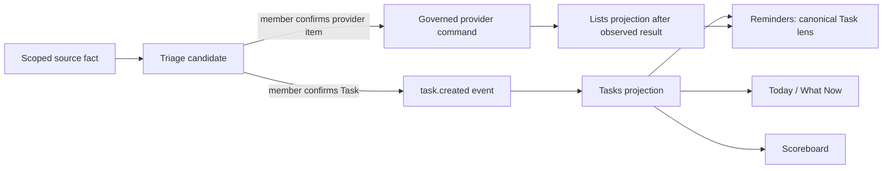

# CO-009 — Cross-surface work lifecycle and member-interface parity

Status: **COMPLETE 2026-08-09 — PRS #302 AND #303 MERGED; GUARDED DEPLOYMENT AND CONTROLLED LIVE RESTART VERIFIED**

Affected surfaces: **Today, Triage, Comms, Reminders, Calendar, People, Notes,
Finance, Scoreboard, Settings**

## Constitutional classification

- **PRESERVE** the encrypted append-only event log, member scope, distinct
  Task/Commitment/List-item/Calendar/Recurrence models, provider authority,
  independent provider approval, observation, provenance, and pinned OpenClaw
  language seam.
- **MODERNIZE** the member work lifecycle, Triage property editor, destination
  receipts, Reminders read composition, local Task controls, and process-level
  cross-surface acceptance.
- **SUPERSEDE** generic string entry for dates/recurrence, arbitrary candidate
  update dictionaries, provider-only Reminders composition, and confirmation
  messages that do not identify the resulting record or destination.
- **DEFER** no broken required lifecycle. Optional provider-native features may
  remain unavailable only when the adapter capability is truthfully disclosed.

## 1. Incident and governing decision

A member confirmed email-derived Task candidates in Triage. The canonical
`task.created` events and Tasks projection rows existed, but Reminders read only
the Lists projection. The member therefore saw a successful confirmation and no
result at the expected destination. This was a projection-orchestration failure,
not an extraction or event-log failure.

The repair is a typed read-time union:

Tasks and provider list items may share a workspace but never share identity,
authority, lifecycle events, or optimistic-concurrency tokens. A local Task is
never labeled provider-synced. A provider item is never silently promoted into
a Task. Calendar events and Commitments remain separate domain facts.

## 2. Triage enrichment contract

The server publishes one versioned `triage-enrichment-v3` contract and derives
its candidate-update allowlist from the same reviewed field definitions used by
the browser. Each target kind receives appropriate controls rather than a raw
dictionary or machine-format string:

| Target | Required member controls |
|---|---|
| Task | due date/time, separate available-from activation, energy, effort, work type, area, first tiny step, notes, member |
| Commitment | owed-to Party, due date/time, urgency, member |
| Calendar event | all-day, start/end date/time, location, availability, notes, reviewed calendar route |
| Provider reminder/list item | capability-filtered date/time, priority, recurrence, early alarm, URL, notes, reviewed account/list route |
| Recurrence | bounded repeat builder, next occurrence, preparation lead, trackability, notes |
| People candidates/facts | authorized Party selectors and type-specific confirmed values |

Date/time controls emit local wall time; the API attaches the reviewed instance
timezone and rejects invalid values before an event is appended. A Task's
`due_date` is its deadline; `available_from` is a separate deterministic
activation boundary used by defer/snooze and never overwrites that deadline.
Elapsed activation boundaries re-enter Today/What Now/Scoreboard through a
clock-explicit read contract while stored lifecycle truth remains auditable.
Recurrence controls generate bounded RRULE values in deterministic browser code. The LLM
does not select fields, destinations, recurrence, priority, or authority.

Visible edits are part of confirmation: an ordinary field change is saved and
settled before the confirm command runs. A target, household-member, provider,
account, or container change is structural and must reload for a separate final
review. The household-member selector is built from configured member
identities, enriched with confirmed Party labels where available; it never
silently substitutes the first projected Party. Missing identity is a blocking
field error.

## 3. Provider capability ceilings

The interface follows actual adapter capability, not apparent native-app
parity. Apple documents Reminders date/time, location, recurrence, priority,
URL, early reminder, and message-person features in its user guide, while
EventKit exposes only the programmatic subset represented by `EKReminder`,
`EKCalendarItem`, recurrence rules, and alarms. Google Tasks API exposes title,
notes, parent/order, status, links, and a scheduled date; its API explicitly
discards the time portion and exposes no priority, alarm, recurrence, or
geofence field. The member UI must explain these ceilings at the chosen route.

- [Apple Reminders user guide](https://support.apple.com/guide/reminders/add-or-change-reminders-remndc729e28/mac)
- [Apple EventKit `EKReminder`](https://developer.apple.com/documentation/eventkit/ekreminder)
- [Google Tasks REST resource](https://developers.google.com/workspace/tasks/reference/rest/v1/tasks)

AdministrateMe-only contextual cues remain typed, scoped, expiring rules. They
do not pretend to be provider alarms and cannot mutate provider truth.

## 4. Navigation-wide lifecycle audit

Each surface is tested as a human-visible stage of one deterministic loop:

| Surface | Cross-surface obligation |
|---|---|
| Today | Active canonical Tasks, Commitments, provider items, calendar time, messages, recurrences, and Triage decisions use the same typed records and links as their destination surface. |
| Triage | Confirmation returns a typed destination receipt and exact link; property controls are schema-driven and route-capability-aware. |
| Comms | Extracted candidates link to Triage; confirmed results do not rewrite message truth. |
| Reminders | Canonical Tasks and provider items are visibly distinct but usable in one calm workspace; lifecycle actions use their own event/adapter paths. |
| Calendar | Only Calendar facts render as events; Task due dates do not become calendar events without a separately confirmed link/write. |
| People | Only confirmed Party/relationship/fact candidates materialize; source senders and free-text IDs do not become People. |
| Notes | Exact-evidence candidates route through Triage; Notes remains source-aware recall, not a direct Task writer. |
| Finance | Financial observations/candidates retain privileged workbook/event authority and route proposed work through Triage. |
| Scoreboard | Open canonical Tasks recalculate progress without importing provider list items as Tasks. |
| Settings | Identity, adapter capability, permissions, observation, and health explain whether each source/destination can participate. |

## 5. Process definition of done

CO-009 is complete only when production-composition tests and rendered browser
simulation prove:

1. Triage Task confirmation creates exactly one canonical Task and immediately
   exposes the same ID in Reminders, Today, and Scoreboard.
2. The same action does not create a provider item or Calendar event.
3. Confirm/retry, Task create/update/lifecycle, projection rebuild, and deep-link
   selection remain idempotent and member-isolated. An exact receipt opens its
   Task in the correct deterministic activation lens and clears incompatible
   presentation filters without authorizing a write.
4. Every Triage target renders bounded type-specific controls with no raw ISO
   placeholder or free-text provider/member/container identifier.
5. Apple/Google controls match the exact chosen route capability.
6. All ten adult navigation surfaces pass desktop and narrow rendered audits,
   accessibility/overflow checks, and zero browser error/failure checks.
7. The full repository, strict acceptance, bridge, plugin, invariant, and clean
   macOS release gates pass before merge or deployment.

Local candidate evidence on 2026-08-09 satisfies conditions 1–7: strict
acceptance passed 39 tests; the complete Python/pack suite passed 1,691 tests;
the bridge passed 60 tests; Ruff, format, mypy, Pyright, dependency audits,
architecture negatives, clean install, tenant isolation, encrypted
backup/restore, package builds, and the pinned OpenClaw contract/15 tests/build/
pack passed. The rendered production-composition harness passed 222 assertions
and retained 36 screenshots across desktop, tablet, and 390-pixel layouts with
no browser console, page, request, accessibility-name, or overflow failure.
The candidate used Python 3.14.6 and the side-by-side Node 24.19.0 toolchain;
the live Node 22 runtime was not changed.

PR #302 merged as `3ab4b7839b0ad867eed326b34c576fd1ffc150cb` and its
attested controller completed guarded activation. Live verification proved the
two confirmed canonical Tasks are present in the member-scoped Reminders union,
but also exposed two release-blocking follow-ups: the receipt retained the exact
item while defaulting to the incompatible Now lens, and restart-time Calendar
discovery re-emitted unchanged source observations and historical elapsed
outcomes. The follow-up corrects exact item/lens routing, durably
deduplicates unchanged calendar-source observations, excludes already-past
history from initial elapsed tracking, and assigns stable idempotency to future
outcome transitions. PR #303 passed Constitution sync and the credential-free
macOS rehearsal, merged as `6d2d6e582a3e76060901ec8f2ccd9bad37b3d72a`,
and deployed through the attested controller without a runtime migration. Live
Triage Recent opened the exact confirmed Task under the automatically selected
Anytime lens, both canonical Tasks remained visible, and observation remained
active. Source assurance settled with zero pending, missing, or failed facts.
A controlled runtime-only restart left Calendar source and outcome counts
unchanged at 388 and 43,510 respectively, proving the restart repair against
the production composition root. CO-009 is complete.
