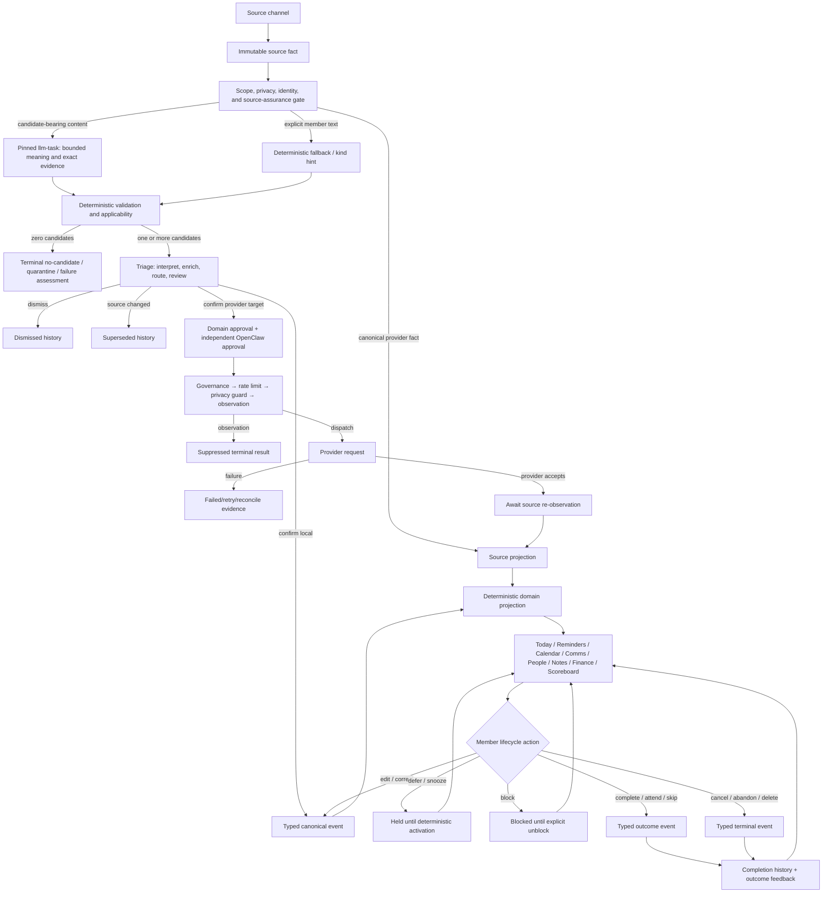

# CO-010 — Whole-life event lifecycle completeness

Status: **CANDIDATE VERIFIED; AWAITING REVIEW, MERGE, AND DEPLOYMENT**

Date: 2026-08-09

Target branch: `codex/event-lifecycle-completeness`, based on current `main`

Affected architecture: event schemas, source assurance, candidate extraction,
Triage, domain commands, projections, Today, Comms, Reminders, Calendar,
People, Notes, Finance, Scoreboard, Settings, OpenClaw bindings, and release
evidence.

## 1. Engineered objective

Replace the unbounded phrase “simulate every event possible” with an
executable completeness contract:

1. Maintain one versioned, machine-readable catalog of:
   - life-event patterns a household must be able to represent;
   - canonical object kinds and their distinct sources of truth;
   - technical event-log schemas and properties;
   - source families and concrete entry channels;
   - candidate target kinds and channel-specific applicability;
   - lifecycle states, actions, triggers, event types, projections, surfaces,
     terminal outcomes, corrections, and retained history.
2. Generate an explicit source-channel × candidate-kind coverage matrix. Each
   cell is `supported`, `not_applicable` with a reviewed reason,
   `optional_not_configured`, or `missing`. Silence is a failure.
3. Generate an object-kind × lifecycle-transition coverage matrix. Every
   required transition names its command boundary, immutable event, projection
   handler, member surface, history surface, and process test.
4. Exercise every `supported` path through the production composition root
   with credential-free provider boundaries, an encrypted event log, the real
   durable bus, all fourteen projections, deterministic pipelines, and the
   production HTTP/browser application. Provider fakes may replace credentials
   and remote systems, but never the event log, bus, projections,
   authorization, routing, or browser boundary under test.
5. Record every failed or unproved cell as a defect. Repair defects in
   dependency order and rerun the matrices until no required cell is missing
   or falsely claimed.
6. Use the pinned OpenClaw `llm-task` seam only to extract bounded language
   meaning, exact evidence, and proposed properties. Reviewed code owns
   eligibility, privacy, scope, identity, deduplication, target applicability,
   route choices, readiness, authorization, priority, state changes,
   scheduling, completion, reconciliation, and health.

“All” therefore means every item declared in the reviewed catalog, plus a
validator that fails when a new schema, adapter source, candidate kind,
lifecycle action, or member surface is added without catalog coverage. It does
not mean an unknowable enumeration of every sentence or future provider.

## 2. Non-negotiable semantic layers

The word *event* previously hid several different concepts. CO-010 uses these
terms precisely:

| Layer | Meaning | Authority |
|---|---|---|
| Life-event pattern | A human situation such as a bill, birthday, appointment, promise, school date, maintenance need, or routine. | Catalog taxonomy; never itself household truth. |
| Source fact | A provider/member observation such as an email, calendar record, reminder, note version, transaction, sensor signal, or exact member intent. | External provider for mirrored state; encrypted event log for the observation. |
| Candidate | A typed, evidence-backed possible change derived from a source fact. | Triage projection over immutable proposal events; never canonical truth. |
| Canonical object | A Task, Commitment, Recurrence, Routine, Party fact, planning fact, or other AdministrateMe-owned typed record. | Encrypted event log; deterministic projection is disposable. |
| Provider object | A Google/Apple calendar event, reminder/list item, message, contact, note, or financial record. | Provider; AdministrateMe records observations and governed command outcomes. |
| Technical event | One registered `EventEnvelope.type@schema_version` describing an immutable fact, decision, command, result, or correction. | Encrypted event log. |
| Projection row | Rebuildable current state or read model. | Never a source of truth. |
| Scheduler job | A clock-driven execution owned by OpenClaw. | Pinned OpenClaw; never a Recurrence or Calendar event. |

No implementation may collapse these layers into a universal event/work object.

## 3. Whole-life pattern catalog

The patterns below are the minimum semantic coverage for 24/7/365 household
management. A single source may yield more than one candidate when the human
situation genuinely requires distinct objects.

| Pattern family | Examples | Required typed representation |
|---|---|---|
| One-time action | Pay this invoice, return a form, buy supplies, call a doctor, make a decision | Task; optional Commitment when owed to a Party |
| Interpersonal promise | “I will send it,” “we owe them an answer,” delegated follow-up | Commitment with direction, Party, due evidence, and source interaction |
| Scheduled presence | Appointment, meeting, class, flight, pickup window, school date | Provider Calendar event or observed calendar fact; optional linked Task/Commitment remains distinct |
| External reminder/list work | Apple Reminder, Google Task, grocery item, packing list | Provider List/List item with exact provider/account/list/revision authority |
| Repeating obligation | HVAC filter, medication refill, recurring bill, license renewal, weekly trash | Recurrence linked to Party, Asset, Account, or Household; `trackable` decides whether occurrences require completion |
| Ordered routine | Morning sequence, bedtime, leaving-school checklist | Routine definition plus ordered occurrence-step outcomes; linked Tasks are not implicitly completed |
| Relationship memory | Birthday, anniversary, employer, preference, address, family relationship | Party/Relationship/Relationship fact; a repeating date is a separate linked Recurrence |
| Household/place/asset fact | Home, vehicle, appliance, warranty, service provider, utility account | Place, Asset, or Account; associated work remains Task/Recurrence |
| Communication obligation | Reply requested, decision requested, bill received, date proposed, member promise | Interaction source fact plus zero or more Triage candidates |
| Note-derived obligation | Meeting notes, transcripts, shared notes, personal notes | Member Knowledge source fact plus exact-evidence Triage candidates |
| Financial fact | Account, transaction, removal, classification, manual correction | Provider/account event or reviewed workbook event in Money projection |
| Financial plan | Budget, assumption, scenario, goal | Reviewed Finance workbook intent; deterministic Money projection |
| Context-sensitive cue | At home, at store, device state, network, location, weather | Expiring Context signal plus Reminder cue; changes presentation/notification eligibility only |
| Automation action | Turn off a device, change a thermostat, execute a household action | Governed command plus observed success/failure; never model-authorized |
| Notification | A reminder should be surfaced or delivered | Signal → deterministic decision → delivery result; delivery is not work completion |
| Evidence/artifact | Document, attachment, receipt, recording | Artifact/Note source fact with provenance; actionable meaning still passes Triage |

## 4. Canonical lifecycle architecture

The closed platform loop remains Observe → Understand → Organize → Propose →
Authorize → Act/project → Verify outcome → Recalculate. The diagram adds the
required branch and terminal semantics without changing ownership.

## 5. Source and candidate-entry inventory

This is the initial current-state audit. The machine-readable catalog and
coverage verifier introduced by this change order become authoritative as the
implementation proceeds.

| Source family / channel | Immutable input | First truthful surface | Candidate assessment today | Current finding |
|---|---|---|---|---|
| Shared-shell Add for review on all eleven adult surfaces | `triage.intent.submitted` | Triage / Needs interpretation | Deterministic text rules and optional kind hint | **Partial:** durable and broad by hint, but no bounded OpenClaw enrichment pass is executed on this path. |
| OpenClaw member chat Add for review | `triage.intent.submitted` through typed tool | Triage | Same member-intent path | Supported when member chat is healthy; generic chat itself is not a source event. |
| Gmail inbound/outbound | `messaging.received` / `messaging.sent` | Comms | `noise_filtering` plus `classify_message_nature` | **Partial:** output schema permits 8 of 11 Triage kinds; source assurance is present. |
| SMS / messaging bridge observation | `telephony.sms_received` | Comms | Same noise-filtering subscriber | **Partial:** source event exists, but no current live family bridge proof. |
| Apple Notes | `member_knowledge.note_*` | Notes | `member_knowledge_indexing` plus `extract_note_semantics` | **Partial:** output schema permits 6 of 11 Triage kinds. |
| Obsidian / Markdown / Voice Memo transcript | `member_knowledge.note_*` | Notes | Same note pipeline | Code/manifest support varies; optional bridges require truthful configuration evidence. |
| Evernote, Otter, Fathom, Zoom, Notion | Provider-neutral Note schema | Notes | Intended note pipeline | **Missing adapters:** schema capability is not an implementation claim. |
| Google Calendar | `calendar.event_*`, `calendar.source_observed` | Calendar / Today | Canonical provider observation, no candidate gate | Correct for already-official calendar truth; source-linked “send to Triage” affordance remains unproved. |
| Apple Calendar bridge | `calendar.event_*` | Calendar / Today | Canonical provider observation | Code support; live per-member bridge/consent is separate evidence. |
| Apple Reminders | `list*`, `list_item*` | Reminders / Today | Canonical provider observation | Provider truth is correctly not re-proposed; source-linked derivative candidate action is unproved. |
| Google Tasks | `list*`, `list_item*` | Reminders / Today | Canonical provider observation | **Defect:** live restart previously re-appended unchanged list/item observations. |
| Contacts providers | `contact.record.*`, `contact.group.observed` | People | Deterministic qualification/identity processing | Candidate promotion paths exist only for reviewed People kinds; channel matrix is incomplete. |
| Plaid | `financial.account_observed`, `money_flow.provider_*` | Finance | Canonical financial observation | Read-only provider path; live consent is not active evidence. |
| Finance workbook | reviewed `finance.*` / manual money events | Finance | Direct typed planning/correction path | Supported locally; lifecycle/completion semantics for goals require explicit matrix proof. |
| Ops workbook | Task/Commitment/Recurrence/Place/Asset/Account events | Domain projections | Direct schema-validated reverse events | Supported local daemon; deletion semantics are uneven. |
| Home Assistant | `ha.state_changed`, `context.signal.observed`, action result | Reminders / Automation evidence | No general candidate assessor | **Partial:** state/cue behavior exists; maintenance/work derivation requires explicit deterministic rules or Triage. |
| Device/location/network/weather context | `context.signal.observed` | Reminders / Today | Cue matching only | Schema exists; concrete adapter coverage is incomplete and must remain truthful. |
| Typed member Task control | `task.created` / task lifecycle events | Reminders / Today / Scoreboard | No Triage when semantics and target are explicit | Supported for self; lifecycle audit finds missing/ambiguous terminal actions. |
| Typed Calendar/Reminder provider control | domain confirmation → approved external command | Source surface, then provider observation | No language extraction | Supported behind approval/governance/observation; provider truth waits for re-observation. |

## 6. Initial lifecycle audit

| Object kind | Required member lifecycle | Current immutable coverage | First/management surfaces | Retained outcome surface | Finding |
|---|---|---|---|---|---|
| Task | propose, confirm, create, edit, defer, snooze, block, unblock, complete, cancel/abandon, correct | `task.created`, `task.updated`, `task.completed`, `task.deleted` | Triage → Reminders/Today | Reminders Completed; Scoreboard intended | **Partial:** defer and snooze are indistinguishable generic updates; no portal abandon action; Scoreboard has no completion history. |
| Commitment | propose, confirm/dismiss, edit, defer, snooze, block/unblock, delegate, cancel/expire, complete | Thirteen typed `commitment.*` events | Triage/Comms → Today | Activity/evidence; Scoreboard intended | **Partial:** schemas exceed current member command/UI actions; delegate/cancel/expire are not fully surfaced. |
| Recurrence | propose, confirm, add, edit, complete/skip occurrence, pause/resume, end | add/update/completed | Triage → Today | Recurrence projection | **Missing lifecycle:** only completion is exposed to the member; no pause/end/occurrence history surface. |
| Routine | define/edit, complete/skip ordered steps, pause/resume/end | defined, step outcome | Today | Today occurrence state | **Missing lifecycle:** no member definition or pause/end flow and no long-term occurrence log surface. |
| Provider Calendar event | candidate review, approved request, source-observed add/update/delete, attend/miss/elapsed, correct outcome | Provider/source and outcome events exist | Triage → Calendar/Today | Calendar evidence | **Partial:** member can record attended/missed only; completed-history presentation needs matrix proof. |
| Provider List/List item | candidate review, approved request, add/update/move, complete/uncomplete/delete, reconcile | Typed provider events and external command results | Triage → Reminders/Today | Reminders Completed | Broad code support; restart idempotency defect and exhaustive operation proof remain. |
| Party/Relationship/Fact | propose, confirm, edit, archive/restore, merge/split, revoke/end/correct | Broad typed People events | Triage → People | People timeline/evidence | **Partial:** candidate channel applicability and every lifecycle command are not process-proven. |
| Note | observe/update/correct/delete, grant/revoke, derive/supersede candidates | Typed Note events and Triage lineage | Notes → Triage | Notes provenance / Triage Recent | Core supported; channel target vocabulary is narrower than global Triage. |
| Finance fact/plan | observe/remove, classify/correct, set/update assumptions/budgets/scenarios/goals | Typed Money/Finance events | Finance/workbook | Finance/workbook/event evidence | **Partial:** goal completion and obligation lifecycle are not represented as a reviewed universal contract. |
| Place/Asset/Account | add/update; archive/delete/correct where permitted | add/update only | workbooks / related surfaces | event evidence | **Missing lifecycle:** retained entities have no uniform reversible retirement semantics. |
| Communication | receive/send, focus state, snooze/quiet, reply/read/archive, provider reconciliation | Interaction, local state, external command events | Comms/Today/Triage | Comms thread/evidence | Core exists; every provider capability path and source-to-candidate kind needs matrix proof. |
| Context cue | configure/clear, signal observe/expire | cue configured/cleared, signal observed | Reminders/Today | evidence | Expiry is read-time; concrete sources remain incomplete. |
| Automation action | approve/request, suppress/dispatch, succeed/fail/reconcile | action/external/observation events | Automation/system evidence | activity/evidence | Needs member-surface and lifecycle-catalog proof. |
| Notification | signal, decide, deliver/fail/retry/expire | signal/decision/delivery result | member delivery surfaces | activity/evidence | Completion must never be inferred from delivery. |

## 7. Current defect register

This register is evidence, not a prioritization shortcut. The generated
coverage database will replace free-form tracking once implemented.

| ID | Severity | Defect |
|---|---|---|
| EL-001 | P0 | No machine-readable catalog or fail-closed verifier covers new technical event types, sources, candidate kinds, transitions, projections, and member surfaces. |
| EL-002 | P0 | Candidate target vocabulary differs across Triage (11), message NLP (8), and Notes NLP (6); the differences are not encoded as explicit applicability decisions. |
| EL-003 | P0 | Member Add for review records a terminal deterministic assessment but does not execute the bounded language-enrichment path described by the architecture. |
| EL-004 | P0 | Task snooze and defer collapse into indistinguishable `task.updated` evidence; action identity is lost from the append-only history. |
| EL-005 | P0 | Required Task abandon/cancel and Recurrence/Routine pause/end paths are absent from member lifecycle commands. |
| EL-006 | P0 | Scoreboard exposes only open next steps, despite constitutional requirements for completed work and dual-path reward evidence. |
| EL-007 | P0 | Google Tasks polling was observed re-appending unchanged source observations on every runtime restart, contradicting restart-idempotency claims. |
| EL-008 | P1 | Provider/source “Send to Triage” affordances described in CO-007 are not present in the production browser code. |
| EL-009 | P1 | Completion and terminal-history presentation is inconsistent across Task, Commitment, Recurrence, Routine, Calendar outcome, provider list item, People, and Finance objects. |
| EL-010 | P1 | Source assurance proves terminal accounting but not semantic source × candidate-kind coverage or lifecycle reachability. |
| EL-011 | P1 | `account`, `asset`, and `place` can be updated but lack reviewed reversible retirement/correction lifecycles; financial-goal completion is only an arbitrary status value. |
| EL-012 | P1 | Several schema-supported or documented sources (Evernote, Otter, Fathom, Zoom, Notion, device/network/weather) have no adapter and must be visible as missing/optional rather than implied support. |

## 8. Implementation gates

1. **Catalog gate:** add the typed catalog, JSON/Markdown generator, and
   validators. Every current registry event and all eleven Triage targets must
   be classified. New uncataloged entries fail CI.
2. **Simulation gate:** add production-composition fixtures for every supported
   source/candidate pair and every required lifecycle transition. Explicitly
   retain `not_applicable` cells with reasons.
3. **SSOT lifecycle gate:** add missing typed transitions and migrations;
   preserve old events with upcasters/read compatibility. Never rewrite facts.
4. **Surface gate:** expose exact source, pending state, allowed next actions,
   and terminal history consistently; repair Scoreboard completion/reward
   evidence and source-to-Triage actions.
5. **Adapter idempotency gate:** repair Google Tasks restart dedupe and prove
   provider identity/revision behavior across restart, replay, and deletion.
6. **Browser gate:** render and interact with every reachable lifecycle state
   on all affected adult surfaces at supported widths, with zero unexpected
   console/page/request errors and server-side scope denial.
7. **Release gate:** update the crosswalk, migration map, UX contract,
   acceptance contract, and handoff; run the full candidate command; review,
   merge, deploy immutably, run Doctor, repeat live observation simulations,
   and retain rollback.

## 9. Definition of done

CO-010 is complete only when:

1. the generated catalog contains no uncataloged technical event, source
   obligation, Triage target, required lifecycle transition, projection, or
   adult member surface;
2. every supported source × candidate and object × transition cell has a named
   passing process test through production composition;
3. every non-applicable cell has a reviewed architectural reason, and every
   optional source reports its real configured/runtime/permission/safety state;
4. candidate extraction may use only bounded schema-validated language output,
   while all routing, lifecycle, authority, and completion decisions are proven
   deterministic;
5. local canonical objects and provider-owned objects retain distinct truth,
   identity, revision, command, observation, correction, and completion paths;
6. every terminal action is queryable as immutable evidence and appears on an
   authorized member-facing history surface without conflating delivery with
   completion;
7. replay, restart, duplicate delivery, source changes, stale commands,
   observation suppression, provider failure, reconciliation, backup/restore,
   and rollback preserve equivalent scoped outcomes; and
8. reviewed merge and live observation-mode evidence agree with the
   constitutional documents. No required cell may be deferred.

## 10. Execution boundary

Phase A uses this clean candidate checkout and credential-free/disposable
instances. It does not mutate the family runtime, disable observation, or make
a real provider write. Phase B begins only after review and merge under the
existing attested upgrade contract.

## 11. Candidate implementation disposition

Sections 5–7 preserve the before-change audit. The reviewed candidate closes
the code defects without pretending that an optional, unconfigured provider is
live. `adminme/lifecycle_catalog.py` and the generated
`docs/refactor/evidence/event-lifecycle-catalog.json` are the executable
current-state inventory.

| Contract dimension | Candidate result |
|---|---|
| Whole-life patterns | 15 named pattern families |
| Candidate entry channels | 11 concrete channels |
| Source × Triage target decisions | 121 of 121 classified; zero missing; every supported cell names a process test |
| Canonical/provider lifecycle families | 23 distinct object families |
| Lifecycle transitions | Zero missing, schema-only, or ambiguous transitions; every exact transition names an existing process test |
| Technical event registry | 183 event types / 213 versioned schemas; zero uncataloged types |
| Triage vocabulary | One closed eleven-kind contract for member intent, messages, notes, and the pinned OpenClaw tool |

### 11.1 Source-to-Triage behavior

- Member Add for review first appends exact text and source lineage, then merges
  fixed-rule results with schema-validated output from the pinned OpenClaw
  `llm-task` seam. A hint limits possible interpretation; it never authorizes
  or materializes a target.
- Gmail/SMS message and Notes workers now accept all eleven proposal kinds.
  Exact quotes remain mandatory. Pipeline versions are replay-on-change, so a
  reviewed deployment reassesses retained source facts, including the existing
  mailbox history, without editing or duplicating those facts.
- Every visible Comms message, Note, Calendar detail, and provider Reminder
  detail can submit that exact source for reassessment. The resulting intent
  retains the source event ID and sensitivity; the browser does not copy a
  source into canonical truth.
- Settled Plaid observations use no model. Three exact-payee observations with
  a closed weekly/monthly/annual spacing rule may propose one privileged
  Recurrence. A settled charge never proves an unpaid Task or Reminder.
- Raw Home Assistant state never invents work. Only a member-bound signal that
  carries a reviewed, typed rule snapshot can deterministically propose a
  Task, Reminder, or Recurrence. Other context facts receive an explicit
  no-candidate assessment.
- Provider Calendar and provider List/List-item observations remain canonical
  provider truth rather than being reflexively re-proposed. Derivative work is
  initiated by an explicit source-linked Triage action or another grounded
  source, preventing loops and duplicate authority.

### 11.2 Lifecycle behavior

- Tasks have typed defer, snooze, block, unblock, cancel, reopen, complete, and
  edit evidence. Activation and deadline are distinct. Completed and abandoned
  history is retained in Reminders and Scoreboard.
- Commitments have typed cancel and delegate semantics. Delegation records that
  the original member handed off a promise; it never assigns an obligation to
  another Party without consent. Unconfirmed proposals expire only from an
  OpenClaw-owned clock tick after the fixed age rule; confirmed promises never
  expire implicitly.
- Recurrences and ordered Routines can be created and edited from Reminders,
  paused/resumed/ended without deletion, completed step-by-step, and reviewed
  with retained occurrence history. Member edits are optimistic and preserve
  scope.
- Calendar attendance, provider List-item outcomes, People lifecycles, and
  communication provider results retain their distinct provider/canonical
  semantics and evidence paths.
- Places, Assets, and Accounts use reversible archive/restore events. Archive
  removes active planning presence but never erases linked history.
- Finance Goal definition and lifecycle are distinct. Pause, completion, and
  reopen use typed events in both the portal and reviewed workbook path. The
  workbook daemon preserves prior status while emitting the typed transition;
  it can no longer overwrite lifecycle as an arbitrary goal property.
- Scoreboard exposes completed, abandoned, cancelled, delegated, expired,
  recurrence/routine, and reward evidence. An immediate completion response
  and asynchronous `reward.ready` delivery point to the same completion event,
  preserving the dual-path deduplication contract.

### 11.3 Defect disposition

| ID | Candidate disposition |
|---|---|
| EL-001 | Closed: typed catalog, generated JSON, totality tests, and new-schema failure gate. |
| EL-002 | Closed: message and Note schemas/skills/pipelines cover the closed eleven-kind vocabulary. |
| EL-003 | Closed: member intent invokes the bounded pinned language seam and deterministic merge. |
| EL-004 | Closed: typed Task lifecycle events preserve action identity. |
| EL-005 | Closed: member Task, Recurrence, and Routine commands and UI cover the required lifecycle. |
| EL-006 | Closed: Scoreboard has terminal histories and linked reward evidence. |
| EL-007 | Closed: Google Tasks fingerprints persist with the durable cursor and unchanged restart polls append nothing. |
| EL-008 | Closed: exact source-linked Triage controls exist on Comms, Notes, Calendar, and Reminders. |
| EL-009 | Closed for declared lifecycle families: terminal history surfaces and named process evidence are cataloged. |
| EL-010 | Closed: source assurance and the 121-cell matrix are both executable gates. |
| EL-011 | Closed: reversible registries and typed Finance Goal lifecycle replace deletion/status ambiguity. |
| EL-012 | Preserved as truthful optional-not-configured coverage; no adapter is implied by a schema. |

### 11.4 Release boundary

The catalog being complete does not itself authorize Phase B. Release still
requires review of the final diff, merge, immutable candidate upgrade, Doctor,
and observation-mode live replay. The full candidate command passed on the
required Python 3.14 / Node 24 test path: 46 strict acceptance tests, 1,715
root/pack tests, 60 isolated bridge tests, static analysis, dependency audits,
builds, clean install, tenant isolation, encrypted backup/restore, OpenClaw
contract/build/tests, and shell checks. The deterministic Gate 7 browser
harness separately passed 223 assertions with zero recorded failures. Optional
adapters remain unavailable until separately installed, configured,
permissioned, and proven healthy.
