# CO-011 — Candidate identification controls and decision-grade Triage context

Status: **IMPLEMENTED IN REVIEWED CANDIDATE; RELEASE EVIDENCE PENDING**

Date: 2026-08-09

Affected architecture: member Settings, source adapters, candidate-bearing
pipelines, the pinned OpenClaw language seam, source assurance, Triage, all ten
member surfaces, event schemas, replay, privacy, and release evidence.

## G02 exact-source policy V2 amendment (2026-08-31)

This change **MODERNIZES** the policy contract while **PRESERVING** V1 as the
only live admission path until G03 or a later separately reviewed activation:

- one immutable coordinate distinguishes tenant, member or service-principal
  owner, optional context member, adapter category/kind/instance, provider,
  provider account, workspace, source kind/class, trusted route, and an
  optional safe native container;
- acquisition, Triage, alert, context, and candidate-kind choices are bounded
  independently, while provider execution remains outside the policy plane;
- `settings.source_policy_v2_changed@v1` is the encrypted, private source of
  truth; the schema-v3 Settings file is a secret-free replayable cache;
- `source.policy_v2.shadow_evaluated@v1` records policy version/revision,
  typed signals, current V1 route, proposed V2 route, exact reasons, and
  `provider_effects:false` for every declared non-terminal source fact;
- ambiguous V1 source-family preferences remain live, are not copied to every
  account, and are reported as migration-needed until the owner chooses an
  exact source policy; and
- owner-only Settings expose Focused, Balanced, Review Everything, bounded
  advanced controls, non-mutating preview, reset, pause/resume, and route
  explanation without exposing prompts, models, regexes, code, credentials,
  or raw configuration.

Direct authenticated member intent remains eligible even if a passive-source
preset is suppressive. Provider labels, sender/provider urgency, and model
claims remain non-authoritative evidence and cannot establish identity,
ownership, priority, routing, policy applicability, disclosure, relationships,
or write authority.

## 1. Engineered objective

Replace the ambiguous request for “candidate identification settings” with one
closed, testable product contract:

1. Publish one executable source-policy catalog covering every stable member
   surface, OpenClaw Add for review, every current candidate-bearing adapter,
   and reviewed future source families.
2. Let an authenticated adult member choose, per source, whether AdministrateMe
   should automatically propose supported candidates, wait for an explicit
   request, or retain the source without proposals. Let the member independently
   limit candidate kinds and optional grounded-language contribution.
3. Keep source retention, terminal source accounting, scope, privacy, exact
   grounding, deterministic eligibility, routing, authorization, human
   confirmation, governance, observation, and provider effects outside this
   setting. Explicit member Add for review remains locked on.
4. Convert an authorized immutable source fact into decision-grade Triage
   context: channel, direction, adapter, account, sender/counterparty, subject,
   observed time, proposed meaning, allowlisted typed fields, literal evidence,
   and extraction-method disclosure.
5. Prove through the production composition root that saved policy reaches
   candidate pipelines, disabled paths still append terminal assessments, and
   Triage context comes from the exact authorized source rather than a model
   paraphrase or copied projection.

The LLM remains a bounded parser. It cannot decide that a candidate is
eligible, infer authority, choose a member or provider route, rank a queue,
materialize truth, or execute a provider change.

## 2. Decision ownership

| Decision | Owner | Member configurable? |
|---|---|---|
| Retain an authorized source observation | Adapter/event contract | No |
| Record terminal candidate assessment | Source-assurance contract | No |
| Run automatic candidate admission for this source | Versioned member policy plus code | Yes: review/manual/quiet |
| Allow a candidate target kind for this source | Reviewed applicability ceiling plus member subset | Yes, within the ceiling |
| Permit grounded language to contribute candidate fields | Member policy plus pack availability | Yes |
| Normalize native/provider fields | Adapter and deterministic transformer | No |
| Match a fixed explicit rule or regex | Versioned code | No |
| Return a literal quote and schema-bound proposed fields | Pinned OpenClaw `llm-task` | Only on/off; never authoritative |
| Validate grounding, fields, scope, dedupe, and applicability | Versioned code | No |
| Select owner, route, priority, or schedule | Deterministic domain rules and the member | No model discretion |
| Confirm canonical truth or a provider command | Authorized human member | No delegation to the model |
| Execute a provider command | Allowlist → governance → rate limit → privacy → observation → independent approval | No bypass |

## 3. Extraction, transformation, and loading contract

```mermaid
flowchart LR
    A["Authorized native observation"] --> B["Encrypted immutable source fact"]
    B --> C["Provider-field normalization"]
    C --> D["Private scope and member-route validation"]
    D --> E["Effective member source policy"]
    E --> F["Versioned rules and bounded regex"]
    E --> G["Optional grounded language extraction"]
    G --> H["Exact-span and schema validation"]
    F --> I["Kind applicability and deduplication"]
    H --> I
    I -->|"zero"| J["Terminal no-candidate assessment"]
    I -->|"one or more"| K["Human-gated Triage proposal"]
    K --> L["Read-time authorized source context"]
    L --> M["Member enrichs, routes, confirms, or dismisses"]
```

The stages are deliberately asymmetric:

- Raw/provider fields may establish direction, identities, exact timestamps,
  native state, recurrence, and provider capabilities. They do not imply a new
  household object.
- Deterministic rules recognize only reviewed signals such as explicit payment
  requests, date/time syntax, fixed first-person promises, cadence snapshots,
  or reviewed context rules. Regex extracts syntax; it does not infer intent.
- Grounded language receives only authorized bounded text through the pinned
  OpenClaw seam. A proposed candidate survives only when its evidence quote is
  a literal substring of the exact input and its fields are in the target
  allowlist. Confidence is provenance, never an admission threshold.
- Code applies member policy, supported-kind ceilings, privacy, duplicate keys,
  and route rules. Every zero, quarantine, or failure remains explicit.
- Triage composes context at read time from the authorized immutable source.
  It never stores a generated summary as truth or exposes source content to a
  member whose current session cannot read it.

## 4. Candidate-kind meaning plan

| Candidate kind | Meaning shown to the member | Required source grounding | Typical deterministic extraction | Optional language contribution |
|---|---|---|---|---|
| Task | A bounded action the member may need to do | Exact request/action phrase or structured reviewed rule | explicit pay/call/send/submit verbs; provider/task fields | concise title, due evidence, effort/energy proposal |
| Commitment | An obligation owed by or to a person | Exact promise/request and direction | outbound first-person future promise; reviewed delegation state | typed direction, counterparty phrase, due evidence |
| Calendar event | Presence at a specific window | Exact date/time/title/location evidence | ISO/date/time spans and provider event fields | title, location, start/end proposal |
| Reminder | A notification or provider reminder proposal | Exact reminder phrase or reviewed native fields | date/location/alarm syntax and capability ceiling | title, notes, due/start proposal |
| List | A named provider-owned collection | Exact list request/name | explicit list construction syntax | normalized list title only |
| List item | One provider-owned collection entry | Exact item text and intended list evidence | native item fields or explicit “add X to list” | cleaned item text and notes |
| Recurrence | A repeating obligation distinct from a scheduler job | Exact cadence or reviewed provider rule | frequency phrases, RRULE parsing, Plaid recurring stream | cadence phrase, next occurrence, link kind |
| Party identifier | One endpoint such as email or phone, not yet a person | Exact provider identifier | normalized endpoint syntax | label suggestion only |
| Party candidate | Evidence that an endpoint/contact may qualify as a Party | Exact contact/source evidence | curated-contact qualification rules | proposed display name only |
| Party relationship | A typed relationship between qualified Parties | Exact relationship statement | reviewed household enrollment/provider relationship fact | typed relationship proposal and literal quote |
| Relationship fact | A scoped fact about a qualified Party | Exact fact phrase/provider field | date/address/employer/preference field rules | typed key/value and literal quote |

## 5. Source/channel policy matrix

Legend: **Review** means automatic candidate assessment may propose; **Manual**
means only an explicit source-linked request may propose; **Quiet** remains
available as a member override. “Current” describes an implemented source
contract, not live enrollment or provider health.

| Projection / source family | Current adapters or entry points | Reviewed future adapters | Native signals | Candidate ceiling | Default |
|---|---|---|---|---|---|
| All ten member projections | Today, Triage, Comms, Reminders, Calendar, People, Notes, Finance, Scoreboard, Settings Add for review | None | exact member text, kind hint, source link | all eleven | Review, locked |
| CoS chat | OpenClaw Add for review tool | None | exact member text and tool provenance | all eleven | Review, locked |
| Comms / email | Gmail plus the fail-closed generic reviewed-message contract | Microsoft Graph Mail | direction, sender/recipients, subject/body, labels/flags, thread, attachments | all eleven, with People kinds still unresolved | Review |
| Comms / chat and SMS | generic reviewed-message contract; provider may be absent | BlueBubbles iMessage/SMS, Twilio SMS, Twilio WhatsApp | direction, participants, body, media, delivery/thread state | all eleven, with People kinds still unresolved | Review |
| Calendar content | Google Calendar, Apple EventKit Calendar | Other reviewed calendar providers | organizer, attendees, title, notes, location, time, recurrence, status | derivative work and People kinds | Manual; automatic assessor planned |
| Reminders / tasks | Google Tasks, Apple EventKit Reminders | Other reviewed task providers | list, title, notes, date/due, status, parent, priority, alarms, geofence, recurrence | derivative schedule/commitment/People kinds | Manual; automatic assessor planned |
| Notes and transcripts | Apple Notes | Apple Voice Memos, Obsidian, Evernote, Otter, Fathom | folder, title/body, checklist, transcript, attachments, revision/share state | all eleven | Review |
| Finance | Plaid transactions and reviewed recurring stream snapshots | Additional reviewed aggregators | amount, merchant, category, cadence, account, pending/removal state | task and recurrence | Review |
| Context / sensors | Home Assistant typed context rule snapshots | Weather/location/device adapters through reviewed Cat-C contracts | entity, state, typed location, expiry, reviewed rule ID | task and reminder | Review only for member-bound reviewed rules |
| People | Apple Contacts, Google People, Microsoft Graph Contacts, CardDAV | Additional curated contact providers | endpoints, name fields, group, provider revision | People kinds | Manual; automatic assessor planned |

## 6. Target applicability by channel type

`R` = raw/provider facts plus deterministic rules may contribute; `L` =
grounded language may contribute; `M` = only explicit manual reassessment;
`—` = not applicable under the reviewed source contract.

| Channel type | Task | Commitment | Calendar | Reminder | List | List item | Recurrence | Identifier | Party | Relationship | Rel. fact |
|---|---:|---:|---:|---:|---:|---:|---:|---:|---:|---:|---:|
| Member exact text / CoS tool | R+L | R+L | R+L | R+L | R+L | R+L | R+L | R+L | R+L | R+L | R+L |
| Email / SMS / message | R+L | R+L | R+L | R+L | R+L | R+L | R+L | L | L | L | L |
| Note / transcript | L | L | L | L | L | L | L | L | L | L | L |
| Provider Calendar content | M | M | — | M | — | M | M | M | M | M | M |
| Provider Task / Reminder content | M | M | M | — | — | — | M | M | M | M | M |
| Plaid transaction / recurring stream | R | — | — | — | — | — | R | — | — | — | — |
| Reviewed Home Assistant context rule | R | — | — | R | — | — | — | — | — | — | — |
| Curated provider contact | — | — | — | — | — | — | — | R | R | R | R |

Already-official provider Calendar, Task, Reminder, Contact, and financial facts
remain authoritative provider objects. Their default Manual path exists only
for a distinct derivative candidate explicitly requested by the member; it
never re-proposes the provider object itself.

## 7. Triage context contract

Every visible proposal must expose the minimum cues required for an accurate
human decision:

| Cue | Source | Fail-closed behavior |
|---|---|---|
| Channel, direction, adapter, account | immutable event envelope/provider fields | show unavailable, never guess |
| Sender or counterparty | direction-aware provider identifier | omit if absent; never infer a Party |
| Subject/source title and observed time | immutable payload/envelope | omit if absent |
| Proposed meaning and target kind | immutable proposal | label as “possible,” never official |
| Due/start/end/cadence/location/priority/fact fields | target allowlist only | discard unknown fields |
| Exact evidence | literal substring of source title/body/notes | say no exact text applies for a structured rule |
| Extraction methods | rule IDs and policy snapshot | disclose provider facts/rules/grounded language |
| Source visibility | current member session authorization | withhold the context rather than leak it |

No generative synopsis is accepted as evidence. The displayed meaning summary
is the proposal’s grounded title; all supporting text is literal source
evidence or a deterministic structured-field label.

## 8. Provider capability findings

This design follows current primary provider contracts, while runtime adapter
manifests remain the executable capability ceiling:

- [Gmail messages, threads, labels, and history](https://developers.google.com/workspace/gmail/api/reference/rest)
  support durable message metadata and incremental history; labels are provider
  facts and do not themselves establish urgency or work.
- [Google Calendar Events](https://developers.google.com/workspace/calendar/api/v3/reference/events)
  expose organizers, attendees, descriptions, locations, time, recurrence, and
  status. An observed provider event is already official provider truth.
- [Google Tasks](https://developers.google.com/tasks/reference/rest/v1/tasks)
  exposes title, notes, status, parent, links, and a due **date** whose time
  component is discarded. The UI and candidate schema must not promise a
  Google Tasks due time.
- [Apple EventKit](https://developer.apple.com/documentation/eventkit) and
  [EventKit event/reminder creation](https://developer.apple.com/documentation/eventkit/creating-events-and-reminders)
  provide calendar/reminder records, recurrence, alarms, and reminder location
  alarms subject to member authorization. Provider modification still requires
  explicit reviewed consent and the AdministrateMe write gates.
- [Microsoft Graph message](https://learn.microsoft.com/en-us/graph/api/resources/message?view=graph-rest-1.0)
  supports sender/from, recipients, subject, body/preview, flags, importance,
  attachments, conversation identity, and change tracking. It remains planned
  until its exact adapter and consent flow pass review.
- [Twilio Messages](https://www.twilio.com/docs/messaging/api/message-resource)
  and [WhatsApp webhooks](https://www.twilio.com/docs/whatsapp/api)
  expose message direction, participants, body/media, and delivery state. A
  provider webhook does not identify a household Party or authorize a reply.
- [Plaid Transactions](https://plaid.com/docs/api/products/transactions/) and
  its recurring-transactions endpoint provide transaction/cadence observations;
  deterministic rules may propose work, but Plaid never owns a household Task.
- [Home Assistant entity contracts](https://developers.home-assistant.io/docs/core/entity/)
  provide typed state. Only a member-bound reviewed rule snapshot can translate
  that state into a candidate; raw entity changes alone are not work semantics.

BlueBubbles, Apple Notes, Voice Memos, Obsidian, Evernote, Otter, and Fathom
require implementation-specific capability and consent review before any
planned row may be promoted to configured or healthy. A Settings preference is
not adapter evidence.

## 9. Persistence, replay, and rollback

- `settings-control.json` advances additively to schema v2 and stores only
  member ID, reviewed source ID, mode, language boolean, supported kind subset,
  timestamp, and revision. It stores no credential or source content.
- Schema v1 is migrated in memory and written as v2 only on the next mutation.
  Corrupt or unknown source-policy rows fail closed.
- `settings.candidate_policy_changed@v1` is a private immutable audit receipt.
  It explicitly records that source retention and routing authority did not
  change.
- The additive V2 cache advances `settings-control.json` to schema v3. Startup
  reconstructs every exact V2 override and owner revision from encrypted
  `settings.source_policy_v2_changed@v1` events; reset is an event, not a
  deletion from audit history. V1 rows and connection pause state remain
  unchanged.
- Ambiguous V1 rows produce content-free migration-needed records. They never
  manufacture provider accounts, workspaces, credentials, scopes, admission,
  disclosure, or provider-write authority, and never expand one source-family
  setting across accounts.
- The shadow consumer compares V1 and V2 only for declared source facts. It
  excludes provider action requests and terminal execution results because
  provider execution is not a source-policy plane.
- Policy applies to new or changed source facts. Existing Triage proposals keep
  their recorded evidence and decision history; quiet mode never deletes or
  rewrites them. Historical reassessment remains an explicit replay/source-link
  action rather than an implicit Settings side effect.
- Message, Notes, Finance, and reviewed context candidate pipelines consume the
  effective policy at execution. Pipeline/skill version changes are replay-safe
  and append new assessments/proposals without mutating source facts.
- Rollback code may ignore the additive settings event and journal map. The
  immutable candidate release remains available; no provider or projection
  migration is required for this change.

## 10. Acceptance

CO-011 is complete only when:

1. catalog tests prove unique source rows, all eleven proposal kinds, current
   and planned states, locked explicit entry, and fail-closed journal parsing;
2. pipeline tests prove review/manual/quiet, kind filtering, language-off
   behavior, exact grounding, and a terminal assessment on every path;
3. production composition proves revisioned/idempotent Settings mutation,
   view-as/child denial, private receipt, no secret disclosure, and a real
   email-to-Triage context with sender, subject, source identity, exact quote,
   methods, and policy snapshot;
4. browser proof exercises Settings at desktop and 390 pixels, keyboard
   controls, current/planned states, save/reload, Triage master/detail context,
   and zero console/page/request errors;
5. the full release matrix, invariant scans, security, replay/isolation,
   backup/restore, clean macOS rehearsal, review, merge, guarded deployment,
   Doctor, source settlement, and authenticated live proof pass without a
   provider effect.

For the G02 V2 amendment, production composition must additionally prove
distinct same-owner accounts and different owners can hold different exact
policies; service-owned sources need no fake member; adults cannot read or
mutate another adult's policy; preview is non-mutating; context-only and ignore
retain their separate semantics and provenance; direct member intent cannot be
suppressed; replay reconstructs settings after the cache is removed; and no
provider terminal reports `provider_called:true`.
