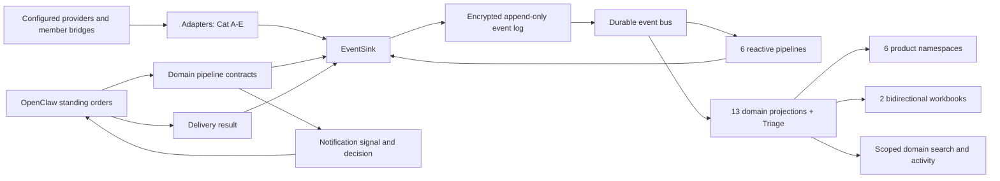

# Gate 6 converged architecture

Gate 6 keeps AdministrateMe as the household domain system and OpenClaw as the
assistant platform. AdministrateMe owns facts, policy, projections, scoped
queries, proposals, workbooks, provider reconciliation, and evidence. OpenClaw
owns scheduling, channel delivery, assistant sessions, and model routing.

## Ownership boundaries

| Concern | Owner | Gate 6 rule |
|---|---|---|
| Household truth and history | AdministrateMe event log | Append first; preserve owner, visibility, sensitivity, source, correlation, and causation. |
| Replay and reads | Thirteen domain projections plus derived Triage | Deterministic apply, checkpoint resume, scoped queries, rebuild from event zero. |
| People and relationship memory | `parties` v2 plus `adminme.people` composition | Endpoints, provider Contact Records, qualified Parties, Identifier Links, memberships, relationships, member profiles, facts, and grants remain distinct; scope is filtered before identity resolution, search, counts, or cues. |
| Contact sources | Cat-B central mirrors or per-member Apple bridge | Provider/account/container/native id/revision remain authoritative; curated records may qualify a Party, while unknown communication/calendar endpoints cannot. Missing enrollment is Not Configured, never healthy. |
| Member Notes | `member_knowledge` plus Cat-D bridge | Provider-neutral, loss-aware Apple Notes, Voice Memos, Obsidian/Markdown, Evernote, Otter, Fathom, Zoom, and optional Notion source contracts; schema support is not a live-adapter claim; never generic conversation memory. |
| Authorized recall/search | `member_knowledge` FTS plus `vector_search` | Query-time owner or explicit adult grant; privileged material is never indexed/model-processed; source deletion or sensitivity change revokes derivatives. |
| Notes semantics | `skill:extract_note_semantics` plus deterministic pipeline | One authorized non-privileged note may yield exact-evidence Triage candidates only; code owns threshold, allowlists, scope, type, and route. |
| Scheduling | OpenClaw automations | AdministrateMe stores program contracts and trigger evidence but runs no product cron. |
| Delivery | OpenClaw plugin | AdministrateMe emits signal/decision; only a delivery-result callback may assert an outcome. |
| Model/provider routing | OpenClaw | AdministrateMe makes one pinned skill request and records returned provenance. |
| Relationship semantics | Deterministic AdministrateMe code | A bounded model call may propose exact-evidence facts to Triage only; it cannot infer identity/access/relationship, rank people, merge, select outreach, or write a contact. |
| Extension behavior | Six pack kinds | Profiles and personas are versioned data; activation is staged, tested, atomic, and reversible. |
| Optional providers | Capability registry | Missing configuration is disabled/blocked, never fabricated health or process failure. |

The old `console/` package had no constitutional household surface—it was a
comment-only server, package metadata, and README placeholders. Its deletion
does not delete the Core, Comms, Capture, Automation, Bridge, or System APIs,
the two workbooks, the OpenClaw dashboard, or the reference UX evidence.
