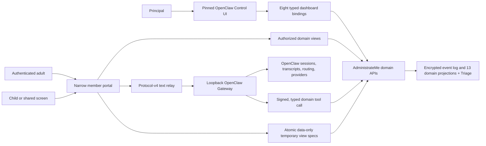

# Gate 7 household experience architecture

## Responsibility split

OpenClaw owns generic conversation, transcript/history, conversational memory,
provider/model routing, fallback/retry, token accounting, runtime
administration, and provider credentials. AdministrateMe owns household
identity, role/scope authorization, domain facts, proposals, guarded writes,
observation, projections, evidence, workbooks, and disposable saved-view
configuration.

## Member chat boundary

The browser calls only `/api/member/v1/chat/{status,history,stream,abort}`. The
server authenticates the Tailscale login at trusted ingress, refuses view-as
chat, applies member/guardian policy and a sliding-window limit, and derives an
opaque actor plus signed OpenClaw session key. The Gateway connection is fixed
to loopback port 18789, protocol version 4, and OpenClaw `2026.7.2`.

Only safe status phases, rendered assistant deltas, terminal state, safe error
code, retryability, and the request correlation id are relayed. Bounded
WebSocket and HTTP streams abort on disconnect/cancellation. Tool XML,
reply/audio directives, control tokens, provider metadata, hidden content, and
raw envelopes are dropped. The portal never accepts a provider/model choice.

For a domain tool call, the plugin validates the session HMAC before creating
portal provenance. The Python tool endpoint independently recomputes the
member binding and compares actor/session in constant time. An operator token
authenticates only the loopback transport. Portal session identifiers are
validated in memory and redacted from persistent tool/proposal audit payloads.

## Temporary surfaces

`TemporarySurfaceStore` writes one schema-versioned JSON file atomically under
the instance configuration directory. A create request can supply title,
purpose, allowlisted query declarations, allowlisted task verbs, allowlisted
required capabilities, compatible modes, and optional expiry. Stable id,
owner, audience, lifecycle status, and versions are server generated.

The only query names are `what_now`, `tasks.open`, `lists.open`,
`calendar.week`, and `finance.recent`. Evaluation ignores cross-scope ids and
calls existing scope-filtered projection query functions under a fresh
request `Session`. Raw event log, SQL, code, script, and arbitrary template
declarations are rejected. Save/delete never appends a task, commitment, list,
calendar, finance, or fabricated project fact.

An active view is private to its owner. Explicit promotion names known adults;
device/ambient audiences are rejected. A child audience additionally requires
`child` compatibility plus the child query/action allowlists. Every read and
action repeats visibility, role, capability, and domain authorization. Expiry
or archive removes navigation; bookmarks show a calm unavailable shell with no
spec or domain payload. The underlying log and all fourteen registered projections remain
unchanged.

## Routes and experience modes

- Adults: Today, Triage, People, Knowledge, Finance, Calendar, Scoreboard,
  Settings.
- Children: Today and Scoreboard.
- Shared screens/devices: Scoreboard.
- Carousel: `adhd_executive`/fog-aware, one ranked action, micro-step, endowed
  progress, bounded decisions, immediate outcome-to-recalculated-next action.
- Compressed: minimalist/dense queue, restrained animation, strict proactive
  cap.
- Child: warm language/rewards, no adult communications, CRM, finance,
  knowledge, settings, or operator control.

The page route and data route each enforce the role allowlist. Navigation
hiding is presentation only. All untrusted values are assigned with
`textContent`; the production portal contains no `innerHTML` rendering seam.

## Degraded and diagnostic truth

Domain projections remain usable if OpenClaw/model chat is unavailable. Chat
states distinguish member-disabled, guardian-disabled, unauthorized,
provider-unconfigured, transport-unconfigured, OpenClaw-degraded, and healthy.
Settings distinguishes disabled, blocked, degraded, healthy, and workbook
not-built states with explicit reasons. Doctor reports portal, deterministic
domain views, chat transport, and model-provider state separately and scans
the final report for referenced secret values.
